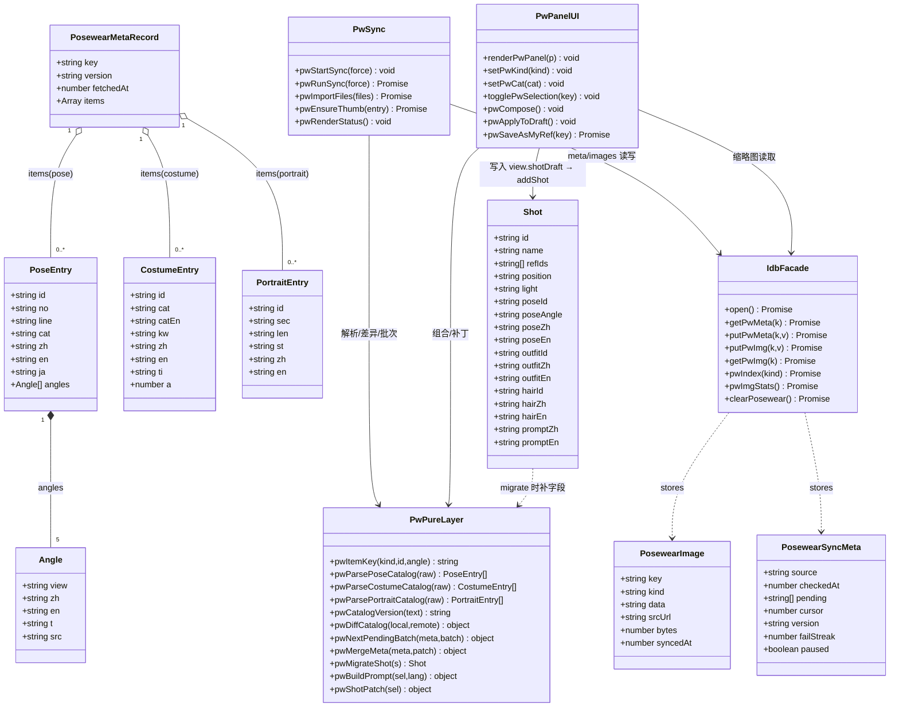
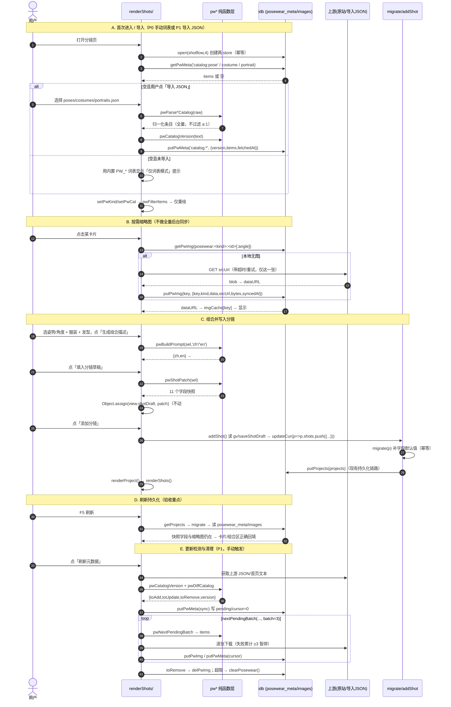
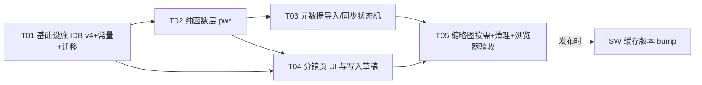

# PoseWear 姿势/服装体系接入 — 增量系统设计

> 作者：高见远（架构师） · 分支：`feature/posewear-sync` · 状态：**设计稿，未实现**
> 范围：仅本文件可写；不改 `shotflow.html`、`tests/`、README、overview，不 commit。
> 前置阅读：`docs/fix-backlog.md` 的 **PW-1** 章节（已核实事实与关键判断不在此重复论证）。
> 本文所有「已查证」结论均于 2026-11-20 从上游公开仓库/站点实测取得；查不到的明确写「未查证」。

---

## 0. 上游研究结论（本次新增的查证结果）

### 0.1 数据在哪里、是什么格式（**已查证**）

上游 `github.com/atuizz/posewear` **不提交姿势/服装/人像的数据 JSON 或图片**。仓库只提交构建脚本与词表；数据由 `scripts/fetch-assets.py` 从原作者图库抓取后本地构建：

| 素材 | 上游站点（源） | 元数据抓取方式 | 仓库内可取的文本 |
|---|---|---|---|
| 姿势 pose | `https://ai-pose-gallery.pages.dev/` | 抓首页 HTML，正则 `const D=(.*?);\n` → `json.loads`；另有 `META/ANG/POSES/PMAP/JA` | `tr_pose.txt`、`words.txt`、`build.py` 的 `LINE/CAT/ANG` 映射 |
| 服装 costume | `https://ai-costume-gallery.pages.dev/` | 同上，`const D=...` | `costume_text.py`（`COL/MOD/N/SOLO` + `gen2()`）、`build.py` 的 `CC` 映射 |
| 动画服装 anime | `https://ai-costume-anime-gallery.pages.dev/` | 同上 | 同 costume，另 1320 套（README 更新日志） |
| 人像 portrait | `https://ai-portrait-gallery.pages.dev/` | 抓 `data/images.js`、`data/ranking.js`，从第一个 `[`/最后一个 `]` 截数组 | `tr_portrait.txt`、`build.py` 的 `LEN/SEC` 映射与模板 |

实测抓取结果（curl `--http1.1 --compressed`）：

- 姿势首页 HTML 450,474 B，`const D` 为 282,529 B 的单行 JSON 数组。首条：
  `{"id":"full_sexy_P001_front","系統":"全身1人・セクシー系","ポーズ番号":"P001","分類":"立ち","ポーズ名":"S字立ち・腰を横に突き出す","アングル":"正面","サムネ":"thumbs/full_sexy_P001_front.jpg","原寸":"img/full_sexy_P001_front.png"}`
- 服装首页 HTML 339,374 B，`const META`：`{"total":1407,"cats":["春","夏","秋","冬","ランジェリー","パーティ","水着","セクシー"],"counts":{...}}`；首条 `{"id":"SPR-0001","カテゴリ":"春","キーワード":"ivory frill knit denim mini skirt coat socks white sneakers","サムネ":"thumbs/SPR-0001.webp","画像":"img/SPR-0001.webp","原寸":"png/SPR-0001.png"}`。
  - 注意：PW-1 记录的 1,068 套与上游当前 `META.total=1407` 不一致；差额主要是**内衣 199 + 性感 140（18+）**，公开部分约 984 套，另有动画服装 1320 套。
- 人像 `data/images.js` 456,477 B，实测 **1,499 条**，字段：`{id,section,hair,style,w,h,full:"img/full/<id>.png",thumb:"img/thumb/<id>.webp",thumb_w,thumb_h,bytes}`。
- 构建产物在 `dist/`：哈希化的 `assets/poses.<hash>.json` / `costumes.<hash>.json` / `portraits.<hash>.json`（`post.py` 的 `put()` 用 sha256 前 10 位命名），前端按哈希路径 fetch。**哈希每次构建都会变**，线上 `https://posewear.pages.dev/data.js` 与首页 HTML 在本环境 curl 超时（WebFetch 可读首页文本），因此**线上哈希 JSON 的字段名逐字一致性未查证**。

### 0.2 分类词表：**硬编码在构建脚本里，可直接取用**（已查证）

不是外部 JSON，而是 Python 字典常量，可人工固化进本工具（无需依赖上游运行时）：

- 姿势系统 `LINE`：`全身1人・セクシー系/全身1人・標準系/上半身1人/2人絡み` → `全身·性感/全身·标准/上半身/双人互动`
- 姿势分类 `CAT`：`立ち→站姿, 座り→坐姿, 膝立ち→跪立, 横座り・女の子座り→侧坐·鸭子坐, しゃがみ→蹲姿, 前かがみ→前倾, のけぞり・反り→后仰, ひねり→扭身, 寝そべり→躺卧, かわいい系→可爱`（另有成人向分类，见风险节）
- 角度 `ANG`（固定 5 个）：`正面→正面/front view, 上から→俯拍/high angle, from above, 下から→仰拍/low angle, from below, 横→侧面/side view, 斜め→斜侧/three-quarter view`
- 服装分类 `CC`：`春/夏/秋/冬/ランジェリー/パーティ/水着/セクシー` → `春季/夏季/秋季/冬季/内衣/派对礼服/泳装/性感`（后两者与内衣为 18+）
- 人像 `SEC`：`face→正脸, styling→生活照`；`LEN`：`ショート/ミディアム/セミロング/ロング → 短发/中长发/半长发/长发`

结论：**词表可以手工固化（P0 就能做）**；完整条目数据需另行导入或后续接通（P1）。

### 0.3 中英文描述的生成方式（已查证，对设计很关键）

| 素材 | 中文描述来源 | 英文描述来源 |
|---|---|---|
| 姿势 | `tr_pose.txt` 硬编码 `日文|中文|英文`（如 `S字立ち・腰を横に突き出す|S形站姿·胯部侧顶|S-curve standing pose, hip pushed out to the side`） | 同一行第三列 |
| 服装 | `costume_text.py::gen2(kw, cat, id)` **运行时生成**，不是硬编码整句；按颜色/材质/单品词典拼装，句式用 `zlib.crc32(id)` 做确定性变化 | 同函数，按 slot 去重拼 `cat+' outfit'` + 单品词 |
| 人像 | `build.py` 模板生成：`一位亚洲年轻女性，{发型}{，风格}，{正脸/生活照描述}。作为人物面部参考，保持五官和脸型一致。` | 模板：`young Asian woman, {hair}, {sec}, consistent facial features, face reference` |

本地复现的真实描述样例（用上游脚本/词表生成，**非线上 JSON 逐字抓取，标为"复现"**）：

- 姿势：`S形站姿·胯部侧顶` / `S-curve standing pose, hip pushed out to the side` ＋ 角度 `正面` / `front view`
- 服装 `SPR-0001`：`外穿大衣，下身配象牙白荷叶边针织牛仔短裙，配袜子，脚踩白色运动鞋。` / `spring outfit, ivory frill knit denim mini skirt, coat, socks, white sneakers`
- 人像：`一位亚洲年轻女性，短发，收腰短发（后颈留长·空气刘海），正面半身肖像，浅灰纯色背景，柔和均匀的光线。作为人物面部参考，保持五官和脸型一致。`
- 线上首页 WebFetch 实测可见真实标题（如「后仰坐·单膝立起」/「站姿·越肩回眸」）与分类「坐姿」「站姿」，与词表一致。

**设计含义**：组合提示词只能复用「描述字符串」，不要试图在本工具内复刻 `gen2()` 的中文生成器；人像模板尾句「作为人物面部参考…」必须剥离，否则会污染出图提示词（见 §5）。

### 0.4 图片 URL 规律与体积量级（部分查证）

| 来源 | URL 规律（已查证字段） | 实测体积 |
|---|---|---|
| 姿势原站 | `https://ai-pose-gallery.pages.dev/thumbs/<id>.jpg`（缩略）、`.../img/<id>.png`（原图）；`id` 形如 `full_sexy_P001_front` | 原图 `full_sexy_P001_front.png` 传输显示总计 **523,791 B ≈ 0.5 MB**；缩略图 GET 超时 → **未查证** |
| 服装原站 | `https://ai-costume-gallery.pages.dev/thumbs/<id>.webp`、`.../img/<id>.webp`、`.../png/<id>.png`；`id` 形如 `SPR-0001` | 缩略图 `SPR-0001.webp` **7,474 B ≈ 7 KB**；原图未查证 |
| 人像原站 | `https://ai-portrait-gallery.pages.dev/img/thumb/<id>.webp`、`.../img/full/<id>.png`；`id` 为 12 位十六进制 | `images.js` 明确给出 `bytes`：1,895,954 / 2,282,845 / 2,360,780 B ≈ **1.9–2.4 MB/张**；缩略图 400×500，具体字节未查证 |
| PoseWear 构建站 | `https://posewear.pages.dev/p/t/<id>.webp`、`/c/m/<id>.webp`、`/r/m/<id>.webp`；原图在独立 assets 站 `/o/p/<id>.png` 等（README 提交记录与 `build.py` `AHOST` 已查证） | 单图字节未查证；WebFetch 可读页面与图片 URL |

**结论**：缩略图 KB 级、人像原图 MB 级。全量同步 1,499 人像原图约 3 GB，**不可行且许可不允许**（人像虽 CC0 但原作者希望不要原样批量转载）。设计必须默认「元数据 + 按需缩略图」，原图不同步。

### 0.5 未查证清单（不得编造）

1. 线上哈希 JSON 的逐字内容、CORS 响应头（curl 超时，WebFetch 仅能读渲染文本）。
2. 姿势缩略图、服装原图、构建站 webp 的确切字节数。
3. `@giaaibusi` 三个 Gallery 的 robots / 使用条款全文；仓库 README 只说明「原站未标明开放许可」。
4. 深度姿势站（`ai-pose-depth-gallery.pages.dev`）不在本设计范围（PW-1 判断 3：热链暴露 IP，不接）。

---

## 1. 实现方案与选型理由

### 1.1 核心挑战

1. **许可与体积**：姿势/服装图片原站未标开放许可，人像 CC0 但不宜批量转载 → 不能沿用 shisei「空闲自动全量下载」模式。
2. **单文件零依赖**：所有新增逻辑必须内联进 `shotflow.html`，且纯函数要能被 `tests/logic.test.mjs` 的 `fn()` + `vm` 抽取。
3. **上游数据不在仓库**：词表可取、完整条目需导入；设计必须双分支（手动词表可独立工作，导入/同步是增量增强）。
4. **分镜页重绘架构**：`renderShots()` 是全量 `innerHTML`（FB-1 教训）→ 新面板必须局部重绘，不能让选姿势清空用户正在输入的分镜草稿。
5. **引用边界**：不能把 PoseWear 图混进 `shisei:` 或 `p.refs` 的 key 空间，否则导出/提案/打印链路会误判来源。

### 1.2 选型：复用什么、不复用什么

**复用（保持项目一致性）**

- `idb.*` 的 Promise 包装风格：每个 store 一组 `getX/putX/delX/xIndex/xStats/clearX` 小方法，`onupgradeneeded` 内幂等 `createObjectStore`。数据库版本 `3 → 4`，新增两个 store。
- 纯函数层形态（现有 `parseCatalog / diffCatalog / nextPendingBatch / mergeShiseiMeta`）：函数名前缀 `pw`、无 DOM、无 idb、无 `parseInt/isNaN`，可被 vm 直接抽取。
- 词表常量形态：仿 `POSITION_OPTS` / `LIGHT_OPTS`（480–481 行）新增 `PW_POSE_CATS / PW_COSTUME_CATS / PW_HAIR_CATS / PW_ANGLES`。
- 迁移入口：在 `migrate(p)`（1013 行）内补分镜字段默认值，保持幂等；不在 `addShot()` 里重复补。
- 分镜页挂载与局部重绘：`renderShots()` 的 `tabBody`（1782 行）内新增 `#pwPanel`，交互只重绘 `#pwPanel` / `#pwCombo`；借鉴 `#shotListWrap` 局部刷新与 `snapshotFocus/restoreFocus`。
- 草稿链路：组合结果写入 `view.shotDraft`，复用 `addShot()` 的既有落库路径（`saveShotDraft` → `updateCur` → `applyDay`），不新增第二条写分镜通路。

**不复用（明确隔离）**

- **不共用 store**：`shisei_meta` / `shisei_images` / `images`（`p.refs` 二进制）完全不写入；新 store 只写 `posewear_meta` / `posewear_images`。
- **不复用同步调用点**：不挂 `startShiseiSync` / `runShiseiSync` / `shiseiCanStart` / `renderShiseiSyncStatus` 的空闲调度与状态机；新建独立的 `pwStartSync / pwRunSync`（触发方式不同：手动/导入优先，非后台空闲全量）。通用模式（版本 diff、pending 游标、批次）以 `pw*` 纯函数重新实现，保持可测。
- **不复用 `SHISEI_CDN_BASE` / `SHISEI_CATALOG_URL` / `shisei:` key 前缀**；统一 `posewear:` 前缀。
- **不新增第 8 个页签**（`TABS` 1390 行不动）；`MATERIAL_SOURCES` 可加一条来源说明条目（P1，且只加文案不改同步链路）。

### 1.3 分层

```
上游文本/词表（手工固化 或 导入 JSON）
   ↓ pwParse*Catalog / pwCatalogVersion / pwDiffCatalog（纯函数，vm 可测）
posewear_meta（版本、条目、pending/cursor）
   ↓ pwNextPendingBatch / idb.pwPutImg（按需、限流）
posewear_images（仅缩略图 dataURL，键 posewear:*）
   ↓ pwBuildPrompt / pwShotPatch（纯函数）
#pwPanel UI（分类/卡片/角度/组合） → view.shotDraft → addShot → p.shots[].* → migrate → projects store
```

---

## 2. 文件与改动区域清单

项目为单文件应用，**「文件」按文件内逻辑区计**（与多文件项目的模块等价）。无新增文件。

| 编号 | 文件 / 区域 | 改动内容 | 阶段 |
|---|---|---|---|
| F1 | `shotflow.html` 常量区（约 471–481 行后） | 新增 `PW_*` 分类常量（**全量，含成人向类目**）、`PW_META_KEY='catalog'`、来源 URL 常量 | P0 |
| F2 | `shotflow.html` 纯函数区（约 741–830 行后） | 新增 `pw*` 纯函数（解析/差异/版本/批次/迁移/组合） | P0 |
| F3 | `shotflow.html` IDB 区（614–642 行） | `indexedDB.open(...,4)`；`onupgradeneeded` 加两个 store；`idb.pw*` 方法组 | P0 |
| F4 | `shotflow.html` `migrate()`（1013–1056 行） | 给每个 shot 补 11 个 PoseWear 字段默认值（幂等） | P0 |
| F5 | `shotflow.html` `renderShots()`（1734–1822 行） | 在 `mineHtml + galleryHtml` 之后、`#s_filter` 之前插入 `#pwPanel`；组合区 `#pwCombo` | P0 |
| F6 | `shotflow.html` `addShot()`（2067–2085 行） | push 对象里带上 11 个字段（取自 `view.shotDraft`，为空即空串） | P0 |
| F7 | `shotflow.html` 同步区（3280 行后，独立段） | `pw*` 导入/同步状态机、缩略图按需获取、清理与配额保护 | P1 |
| F8 | `shotflow.html` 文档导出区（3048–3095 行、3113–3149 行） | 按管理员决定条件性输出中英描述 / PW 参考图列（**确认前不改**） | 阻塞后 |
| F9 | `tests/logic.test.mjs`（21–23 行抽取清单 + 新增断言段） | 注入 `pw*` 函数、列出断言点（详见 §10） | P0 |
| F10 | `docs/fix-backlog.md` PW-1 | 实施时回填决策与进度（本设计不改该文件） | 后续 |
| F11 | SW 缓存版本（部署时） | UI 结构变化需 bump PWA 缓存版本（与现有发布流程一致） | 发布时 |

---

## 3. 数据结构与接口

### 3.1 IndexedDB 设计（与既有三者边界清晰）

```js
indexedDB.open('shotflow', 4)   // 3 → 4
onupgradeneeded:
  if(!contains('posewear_meta'))   createObjectStore('posewear_meta')
  if(!contains('posewear_images')) createObjectStore('posewear_images')
```

| Store | Key | Value | 与相邻的边界 |
|---|---|---|---|
| `posewear_meta` | `'catalog:pose'`, `'catalog:costume'`, `'catalog:portrait'` | `{version, fetchedAt, items:[...]}` | 不写 `shisei_meta`（其 key 为 `catalog`） |
| `posewear_meta` | `'sync'` | `{source, checkedAt, pending:[key], cursor, version, failStreak, paused, lastError}` | 独立光标；不动 shisei meta |
| `posewear_images` | `posewear:p:<gid>:<angle>` / `posewear:c:<cid>` / `posewear:r:<rid>` | `{key, kind, data(dataURL), srcUrl, bytes, syncedAt}` | **所有 key 以 `posewear:` 开头**；`shisei:` 归 shisei store；上传图 key 归 `images` store 并被 `p.refs` 引用 |
| `images`（不变） | 上传图 key | 用户二进制 | PW 图不自动进入；只有显式「存为我的素材」才经压缩链路写入 |
| `projects`（不变） | `'all'` | 项目数组 | 只在 shot 上加字段，不改 `refs`/`shisei` 语义 |

`idb` 新增方法（沿用现有风格，逐 store Promise 包装）：

```
getPwMeta(k) / putPwMeta(k,v) / delPwMeta(k)
putPwImg(k,v) / getPwImg(k) / delPwImg(k) / pwImgKeys() / pwImgStats() / clearPosewear()
pwIndex(kind)   // 游标遍历 posewear_images，返回 {key,kind,zh,en,cat} 精简索引，供卡片渲染
```

### 3.2 条目对象模型（写入 meta 的 `items`）

```js
// 姿势（组为单位，角度内联；id 即上游 d.id 去掉末尾 _<angle>）
{ id:'full_single_P001', no:'P001', line:'全身·标准', cat:'坐姿',
  zh:'后仰坐·单膝立起', en:'...', ja:'...',
  angles:[{ view:'front', zh:'正面', en:'front view',
            t:'p/t/full_single_P001_front.webp', src:'https://ai-pose-gallery.pages.dev/thumbs/...jpg' }] }
// 服装
{ id:'SPR-0001', cat:'春季', catEn:'spring', kw:'ivory frill knit ...',
  zh:'外穿大衣，下身配…。', en:'spring outfit, ...', ti:'大衣 + 荷叶边针织牛仔短裙',
  t:'c/m/SPR-0001.webp', src:'https://ai-costume-gallery.pages.dev/thumbs/SPR-0001.webp', a?:1 }
// 人像（发型条目，描述尾句在本工具内剥离）
{ id:'f71f980dde3', no:'S001', sec:'生活照', len:'短发', st:'收腰短发（后颈留长·空气刘海）',
  zh:'一位亚洲年轻女性，短发，收腰短发…。', en:'young Asian woman, short hair, ...',
  t:'r/m/f71f980dde3.webp', src:'https://ai-portrait-gallery.pages.dev/img/thumb/...webp' }
```

`a:1` 表示上游成人向分类（内衣/性感/性感·大胆/全身·性感/双人互动）；**管理员已决定全量内置、不做 18+ 开关与默认隐藏**（§9 决策 B），`a:1` 仅作数据来源标记，不用于过滤或界面分级。

### 3.3 分镜字段（确切字段名）与迁移策略

在 `p.shots[]` 上新增 **11 个扁平字段**（与现有 `position`/`light` 同风格，便于 vm 断言与模板读取）：

| 字段 | 类型 | 含义 |
|---|---|---|
| `poseId` | string | 姿势组 id，如 `full_single_P001`；空串 = 未选 |
| `poseAngle` | string | `front/high/low/side/diag`；空串 = 未选 |
| `poseZh` / `poseEn` | string | **写入时快照**的姿势名＋角度描述（同步更新不改旧分镜） |
| `outfitId` | string | 服装 id，如 `SPR-0001` |
| `outfitZh` / `outfitEn` | string | 服装描述快照 |
| `hairId` | string | 人像 id，如 `f71f980dde3` |
| `hairZh` / `hairEn` | string | 发型短语快照（已剥离「面部参考」尾句） |
| `promptZh` / `promptEn` | string | 组合描述快照（`pwBuildPrompt` 输出） |

迁移：在 `migrate(p)` 的 `p.shots.forEach` 内追加：

```
['poseId','poseAngle','poseZh','poseEn','outfitId','outfitZh','outfitEn',
 'hairId','hairZh','hairEn','promptZh','promptEn']
  .forEach(k => { if (s[k] == null) s[k] = ''; })
```

- 用 `== null` 而非 `!s[k]`，不覆盖已存空串以外的值；重复调用结果字节一致（幂等）。
- **不删字段、不改 `refIds`**：老项目升级后 12 个字段全为空串，UI 正常显示「未选择」。
- 快照策略理由：上游词表会更新（哈希 JSON 每次构建变化），旧分镜必须保持当时选中的描述，否则提案/手册内容会漂移。
- `pwShotPatch(sel)` 返回上述字段的对象，`addShot()` 从 `view.shotDraft` 读取合入；不新增第二个写入口。

### 3.4 类图（Mermaid）



---

## 4. 关键函数签名（纯函数层，vm 可抽取）

**硬约束**：函数体内不得出现 `document / window / localStorage / idb / fetch / parseInt / isNaN / Boolean(...)`；只用 `String/Number/Array/Object/JSON/Math/RegExp/Set/Map/Date` 与纯计算。所有函数在 `shotflow.html` 顶层以 `function pwXxx(...)` 声明，便于 `fn(name)` 定位。

| 函数 | 签名 | 职责 / 返回 |
|---|---|---|
| `pwItemKey` | `(kind:string, id:string, angle?:string) => string` | `posewear:<kind>:<id>[:<angle>]`，`angle` 空则省略 |
| `pwParsePoseCatalog` | `(raw:any) => PoseEntry[]` | 兼容 `{items:[]}` 与裸数组；折叠 `id` 末段角度；丢弃 `_src`；角度白名单过滤 |
| `pwParseCostumeCatalog` | `(raw:any) => CostumeEntry[]` | **不过滤** `a:1`（管理员决定全量内置），保留 `zh/en/ti`；缺描述时用 `kw` 兜底 |
| `pwParsePortraitCatalog` | `(raw:any) => PortraitEntry[]` | 用 `len/st` 重建短语，剥离模板尾句「作为人物面部参考…」 |
| `pwCatalogVersion` | `(text:string) => string` | `len + '-' + djb2hash`，仿 `shiseiCatalogVersion`，上游文本变即版本变 |
| `pwCatalogSame` | `(a:PoseEntry, b:PoseEntry) => boolean` | 比较 `zh/en/cat/angles`；用于更新检测 |
| `pwDiffCatalog` | `(local:any[], remote:any[]) => {toAdd,toUpdate,toRemove}` | 按 `pwItemKey` 建索引；不依赖 Map 也可（用对象） |
| `pwNextPendingBatch` | `(meta:object, batch:any) => {items,cursor,done}` | 与 `nextPendingBatch` 同语义，独立实现，避免共用 shisei 函数 |
| `pwMergeMeta` | `(meta:object, patch:object) => object` | 浅合并，原型安全 |
| `pwMigrateShot` | `(s:object) => object` | 补 12 个字段（含 id 共 12：11 项 + prompt 两项合并计数以表 3.3 为准，实际 12 键）；`migrate()` 内部调用或 inline 同逻辑 |
| `pwHairPhrase` | `(p:PortraitEntry, lang:'zh'\|'en') => string` | 只取 `len` + `st`，保证不出现「face reference」 |
| `pwBuildPrompt` | `(sel:object, lang:'zh'\|'en') => {zh:string,en:string}` | 组合规则见 §5；空选择返回空串 |
| `pwShotPatch` | `(sel:object) => object` | 返回可合入 `view.shotDraft` 的全部字段快照（含 `promptZh/promptEn`） |
| `pwFilterItems` | `(items:any[], cat:string, kw:string, allowAdult:boolean) => any[]` | 分类/关键词筛选，纯数组操作 |

`pwMigrateShot` 若被 `migrate()` 内联，则 `migrate()` 本身仍需保持自包含（现有测试单独抽取它）；建议**内联在 `migrate()` 里**，另提供 `pwMigrateShot` 供新断言独立验证，二者逻辑逐字一致并在测试中比对结果。

---

## 5. 组合逻辑与真实示例

### 5.1 拼接规则（确定性、可测）

输入 `sel = {pose:{id,zh,en,angle:{view,zh,en}}, outfit:{id,zh,en}|null, hair:{id,len,st,zh,en}|null}`。

**中文**（各段非空才参与，段间 `，`，末尾 `。`）：

1. `人物/发型`：`一位亚洲年轻女性，` + `hair.len` +（`hair.st` 非空则 `（hair.st）`）；无 hair 则整段省略。
2. `姿势×角度`：`pose.zh` + `（` + `angle.zh` + `）`。
3. `服装`：`outfit.zh` 去掉末尾 `。` 后原样加入（服装描述已是完整句，保留其句式）。
4. 依次拼 `段1，段2，段3。`；若只有姿势，则 `pose.zh（正面）。`

**英文**（段间 `, `，无句号）：

1. `young Asian woman` + `hair.en`；2. `pose.en` + `, ` + `angle.en`；3. `outfit.en`。

**强制规则**

- `pwHairPhrase` 必须剔除上游模板尾句 `。作为人物面部参考，保持五官和脸型一致。` / `, consistent facial features, face reference`；只留发型与风格。
- 不做中文→英文翻译，不调用任何 AI；中英各取上游既有字符串。
- 顺序固定：**人物/发型 → 姿势×角度 → 服装**；与 PoseWear「组合提示词」同维度但自实现，不复制其前端代码。
- 结果写入 `promptZh/promptEn` **快照**；用户可在 UI 里手动编辑草稿备注（`s_note`），组合不覆盖 `note`。

### 5.2 真实示例（描述来自 §0.3 的上游词表/生成器本地复现；线上逐字一致性未查证）

- 选：姿势 `S形站姿·胯部侧顶` × `正面`；服装 `SPR-0001`；人像 `短发 / 收腰短发（后颈留长·空气刘海）`
- 中文输出：
  `一位亚洲年轻女性，短发（收腰短发（后颈留长·空气刘海）），S形站姿·胯部侧顶（正面），外穿大衣，下身配象牙白荷叶边针织牛仔短裙，配袜子，脚踩白色运动鞋。`
- 英文输出：
  `young Asian woman, short hair, layered short hair with longer nape, see-through bangs, S-curve standing pose, hip pushed out to the side, front view, spring outfit, ivory frill knit denim mini skirt, coat, socks, white sneakers`
- 仅选姿势 + 服装（无人像）：中文从 `S形站姿·胯部侧顶（正面），外穿大衣…。` 起；英文从 `S-curve standing pose, hip pushed out to the side, front view, spring outfit, ...` 起。

---

## 6. UI 挂载点（不新增第 8 个页签）

**位置**：`renderShots()` 组装 `tabBody` 时，在 `mineHtml + galleryHtml`（1816 行）之后、`#s_filter`（1817 行）之前插入：

```
<div class="card" id="pwPanel"> … </div>
```

**内容结构**

- 标题行：`动作与穿搭 · PoseWear 参考` + 来源致谢（上游作者/仓库链接，文案仿 `MATERIAL_SOURCES`）+ 状态徽标（未导入 / 已导入 N 条 / 同步中 / 已暂停）+ 按钮「导入 JSON」「刷新元数据」。
- 三维切换（segmented）：`view.pwKind = 'pose'|'costume'|'portrait'`（默认 `pose`）。
- 分类 chips：`PW_POSE_CATS / PW_COSTUME_CATS / PW_HAIR_CATS`（**全量，含成人向类目**），由 `view.pwCat` 控制；**无 18+ 开关、无默认隐藏**（§9 决策 B）。
- 关键词输入：`#pw_kw`（`oninput` 防抖 → 只重绘 `#pwGrid`）。
- 卡片网格 `#pwGrid`：缩略图来自 `idb.pwIndex(kind)` + `imgCache[key]`（无图显示占位）；标题 zh + en；姿势卡片额外 5 个角度 chip（`pwSelectAngle`）。
- 组合区 `#pwCombo`：当前选择摘要 + 中/英切换（`view.pwLang`）+ 可复制文本域 + 按钮「生成组合描述」「填入分镜草稿」。
- 「填入分镜草稿」调用 `pwShotPatch(sel)` → `Object.assign(view.shotDraft, patch)` → 局部更新 `#pwCombo` 提示「已填入，点『添加分镜』落库」；**不直接 addShot**，保持用户可控。
- 「用作我的参考图」（可选，P1）：显式把某张 PW 缩略图经现有 800px/JPEG 压缩链路写入 `images` store + `p.refs`，之后可按 `toggleRef` 选入 `s.refIds`。**不自动写入 `refIds`**。

**重绘纪律（FB-1 教训）**：所有 PW 交互只替换 `#pwPanel` 或 `#pwGrid` / `#pwCombo` 的 `innerHTML`；禁止调用 `renderShots()` 全量重绘（`selRefs`/分类 chip/同步完成钩子除外，且需 `snapshotFocus/restoreFocus`）。`#s_name`、`#s_note` 等草稿值继续由 `view.shotDraft` 回填，PW 操作不触碰它们。

---

## 7. 程序流程（时序图，Mermaid）



**同步策略要点（P1）**：与 shisei 不同——默认**不后台空闲全量同步**；只同步元数据（文本，MB 级）与用户点开过的缩略图（KB 级）。`pending/cursor/version/failStreak/paused` 语义沿用现有模式，保证中断可续、重复导入幂等（`toUpdate` 才覆盖）。清理：上游条目消失 → 删 `posewear_images` 对应 key；用户点「清空 PoseWear 数据」→ 事务内 clear 两个 store（`clearPosewear()`），不触碰 shisei/images/projects。`QuotaExceededError` 立即暂停并提示，不重试风暴。

---

## 8. 任务列表（有序，按实现顺序）

> 依赖包：**无新增第三方依赖**（保持单文件零依赖、零构建）。测试用现有 `node tests/logic.test.mjs`。

| ID | 任务名 | 优先级 | 改动文件 / 区域 | 依赖 | 预估影响面 |
|---|---|---|---|---|---|
| T01 | 基础设施：IDB v4 两 store + 词表常量 + 迁移字段 + vm 注入 | **P0** | F1 常量区、F3 IDB 区、F4 `migrate()`、F9 测试抽取清单 | — | `indexedDB.open` 版本号变化（需升级验证）；老项目 `migrate` 补 12 字段；88 项测试不回归 |
| T02 | 纯函数层：`pw*` 解析/差异/版本/批次/组合/补丁 | **P0** | F2 纯函数区、F9 断言段 | T01 | 仅新增函数，不改现有函数；vm 可抽取性必须成立 |
| T03 | 元数据导入与同步状态机（手动 JSON + 版本检测 + 游标） | **P1** | F7 同步区（独立段）、F1 来源文案 | T01, T02 | 新增 `pwStartSync/pwImportFiles`；不挂 shisei 调度；网络失败不影响主流程 |
| T04 | 分镜页 UI：`#pwPanel` 分类/卡片/角度/组合/写入草稿 | **P0** | F5 `renderShots()`、F6 `addShot()` | T01, T02 | 分镜页 DOM 增加约 1 个 card；必须局部重绘，FB-1 回归风险最高 |
| T05 | 缩略图按需获取 + 清理/配额保护 + 浏览器验收（真实数据+刷新持久化） | P1（验收项 P0） | F7 缩略图与清理段、F11 发布缓存版本 | T03, T04 | 影响 IDB 占用与 SW 缓存；需真机/浏览器验证 |

**P0 判定**：T01/T02/T04 完成后，即使 T03/T05 未做，用户也能在分镜页看到词表、选姿势/服装/发型、生成中英组合描述并写入分镜——满足「让用户看到东西」。T03/T05 是可后续接的同步与图片增强。

### 任务依赖图（Mermaid）



---

## 9. 风险与未决项（PW-1 三问已由管理员 2026-11-20 拍板，不再是阻塞项）

> 决策记录（原话与推理见 `docs/fix-backlog.md` PW-1「管理员决定」）：
> **A = 不进客户提案，可进执行手册**（管理员 2026-11-20 二次澄清「手册就是我看的，不是客户看的，可以进」）：客户可见物料 = 客户提案（含导出 HTML）；中英文描述与 PW 图不进提案，但允许进执行手册（内部物料），同时在 shot 快照 + `#pwPanel` 界面展示/可复制。
> **B = 全量内置，无 18+ 开关**（管理员 2026-11-20 二次澄清「不配套 18+ 开关，动作姿势本来就没有必要做这个分类」）：放开 `a:1` 类目，词表补齐；**不引入年龄确认弹窗/开关/默认隐藏**，导入过滤同步放开，成人向类目与其他类目等同展示。
> **C = 进手册**：shot 增加 `pwPrintKeys:string[]`，执行手册参考图列按 key 取图打印；`promptZh/promptEn` 同样允许进执行手册「动作与穿搭」列。**两者都不进客户提案**——实现按文档类型分支，勿做成「不进任何导出文档」。
> 以下保留原「确认前默认 / 确认后分支」作为决策依据存档；实现按上述已选分支，不再按默认落地。

### 9.1 阻塞项 A — 中英文描述是否进客户可见文档

- **确认前（默认）**：描述只存进 shot 快照字段 + 在 `#pwCombo` 界面展示/可复制；**不改** `openDoc('proposal')` 与执行手册（3048–3095 行）。导出物与今天完全一致。
- **确认后分支**：
  - 「执行手册进」：在 3048 行 `anyPos/anyLight` 旁加 `anyPrompt = p.shots.some(s=>s.promptZh||s.promptEn)`，按需追加「动作与穿搭」列，内容取快照（不实时查 meta）。
  - 「客户提案也进」：在提案分镜表（3113 行起）追加同样的条件列；注意长度与排版（`PUBLIC_STYLE` 的 `.doc table` 字体 13px）。
  - 「都不进」：保持确认前默认；可选在 UI 增加「复制描述」按钮满足内部使用。

### 9.2 阻塞项 B — 词表完全照搬还是筛选精简

- **确认前（默认 = 精简）**：内置 `PW_*` 只含 PW-1 列出的中性类目（可爱/坐姿/站姿/跪立/躺卧/侧坐·鸭子坐/蹲姿/前倾/后仰/扭身；春/夏/秋/冬/派对礼服/泳装；正脸/生活照 + 4 种发长）；**排除** `内衣/性感/性感·大胆/全身·性感/双人互动` 等 `a:1` 成人类目，且导入时用 `pwParse*Catalog` 过滤。
- **确认后分支**：
  - 「完全照搬」（**已选，且管理员二次澄清不要 18+ 开关**）：放开 `a:1`，分类词表补齐 `内衣/性感/双人互动` 等；**不增加 18+ 开关与年龄确认**；UI 与导入过滤处同步放开。原存档中"增加 18+ 开关"的说法已作废。
  - 「筛选精简」：维持默认；可再按管理员指定的类目白名单删减。

### 9.3 阻塞项 C — 同步图片是否进执行手册参考图列

- **确认前（默认 = 不进）**：PW 缩略图只在 `#pwPanel` 内显示；不写 `s.refIds`、不写 `p.refs`、不被 3069 行的参考图列读取。用户若想用，必须点「用作我的参考图」显式转成用户素材（此时按现有 `p.refs` 规则参与手册）。
- **确认后分支**：
  - 「进手册」：在 shot 上再增加一个显式选择字段（如 `pwPrintKeys:string[]`，存 `posewear:` key），手册列按 key 从 `posewear_images` 取图；打印前需把 dataURL 内联，注意体积与分页（335 行 CSS 的 112px 参考图）。
  - 「只做界面参考」：维持默认，且**不提供**「用作我的参考图」自动勾选，保持边界绝对清晰。

### 9.4 非阻塞但重大的风险

| 风险 | 等级 | 说明 / 缓解 |
|---|---|---|
| **图片许可** | **最高** | 上游 README 明确：姿势/服装图片归 @giaaibusi，原站未标开放许可，「想转载、商用或二次分发请先联系原作者」；人像虽 CC0 但作者希望不要原样批量转载。→ 默认只同步**文本元数据**；只缓存用户主动点开的缩略图；不同步原图；UI 常驻来源致谢。是否进一步使用需管理员决定。 |
| 上游哈希 JSON 不稳定 / CORS 未查证 | 高 | `post.py` 每次构建换哈希；线上在本环境 curl 超时。→ P0 走手工固化词表 + 本地文件导入；P1 自动同步仅作增强，失败降级不影响 UI。 |
| 浏览器直连原站超时 | 高 | 本环境 curl 加 `--http1.1 --compressed` 才通，浏览器可能不通。→ 缩略图按需、带超时/重试/失败上限；无图也有占位卡片，功能不依赖图片。 |
| 配额爆炸 | 中 | 人像原图 ~2 MB × 1499 ≈ 3 GB。→ 永不自动同步原图；只存 webp 缩略图；`pwImgStats()` 显示占用；`QuotaExceededError` 暂停。 |
| 分镜页全量重绘回退 | 中高 | FB-1 已发生一次。→ PW 交互禁止 `renderShots()`；验收必须含「输名字→点 PW 卡片→名字仍在」。 |
| 数据漂移 | 中 | 上游描述更新后旧分镜变化。→ 写分镜时存快照，不实时引用 meta。 |
| SW 缓存 | 中 | 新增 UI 结构需 bump 缓存版本，否则用户看到旧页面。 |

---

## 10. 测试策略

### 10.1 逻辑测试断言点（`tests/logic.test.mjs`，只列断言，不写代码）

现有 88 项必须全绿；新增函数加入 21–23 行的 `fn()` 抽取清单。

1. `pwItemKey`：三种 kind 的 key 前缀/`posewear:` 拼接正确；`angle` 为空不产生尾冒号；非法输入不抛错。
2. `pwParsePoseCatalog`：兼容裸数组与 `{items}`；`id` 末段角度折叠为 1 组；`angles` 长度 5；过滤非白名单角度；`_src` 不泄漏进输出。
3. `pwParseCostumeCatalog`：**`a:1` 不过滤（管理员决定 B，全量内置）**；缺 `zh/en` 时用 `kw` 兜底；`ti` 保留。
4. `pwParsePortraitCatalog`：尾句「作为人物面部参考…」被剥离；`len/st` 保留；英文 tail `face reference` 被剥离。
5. `pwCatalogVersion`：同文本同版本；改一字版本不同；空串有稳定值。
6. `pwDiffCatalog`：新增/更新/删除三类计数正确；同内容不产生 `toUpdate`；重复调用幂等。
7. `pwNextPendingBatch`：`batch=3` 分批；`cursor` 累加；末批 `done:true`；`pending` 非数组时不抛错。
8. `pwMergeMeta`：`patch` 覆盖同键、保留未提及键；不改入参。
9. `pwMigrateShot`：12 个字段补齐；已有值不被覆盖；连续两次调用结果 `JSON.stringify` 相同；与 `migrate()` 内联逻辑结果一致。
10. `pwHairPhrase`：中英均不含「面部参考 / face reference」；空输入返回空串。
11. `pwBuildPrompt`：三选齐全时中英段落顺序正确；仅姿势时退化为 `姿势（角度）。`；空选择返回 `{zh:'',en:''}`；中文末尾仅一个句号；英文无句号；与 §5.2 的真实样例逐字一致。
12. `pwShotPatch`：返回 12 个字段快照；不修改入参 `sel`；与 `pwBuildPrompt` 的 `promptZh/promptEn` 一致。
13. `pwFilterItems`：分类+关键词组合过滤；`allowAdult=false` 时 `a:1` 不可见（**纯函数语义保留，UI 恒传 `true`，不构成 18+ 开关**）；空筛选返回全量。

### 10.2 浏览器端验证要点（**必须做，不能只验标记**）

1. **真实数据 + 刷新持久化（最高优先）**：导入真实上游 JSON（或用固化词表），选一组姿势 × 角度 + 服装 + 发型 → 生成组合 → 填入草稿 → 添加分镜 → **F5 刷新** → 打开该分镜，确认 12 个字段与 `promptZh/promptEn` 原样保留；再刷新一次确认不漂移。
2. **缩略图真实行为**：点击一张 PW 卡片 → 确认 `posewear_images` 里出现对应 `posewear:*` key（`pwImgStats()` 计数 +1）→ 刷新后卡片仍显示图片（不是只检查「同步完成」标记）。
3. **三库边界**：操作后 `shisei:` key 数量不变、`images` store（`p.refs`）数量不变、控制台无跨 store 写入；`clearPosewear()` 后 shisei 与 refs 仍在。
4. **草稿不丢（FB-1 回归）**：输入分镜名称 → 切 PW 分类 → 点 PW 卡片 → 点角度 → 生成组合，名称/备注/日期保持；点「添加分镜」才清空。
5. **幂等/更新**：同一 JSON 导入两次，条目数不变、无重复 key；改动 JSON 中一条描述后再导入，只有该条进入 `toUpdate`，旧分镜快照不被改写。
6. **失败降级**：断网时 PW 面板仍可显示词表与组合；缩略图占位正常；无未捕获异常；同步状态显示「已暂停」而非卡在「同步中」。
7. **全量类目可见**：内衣/性感等 `a:1` 类目与其他分类一样出现在 chips 与卡片列表；界面无 18+ 开关、无年龄确认弹窗、无默认隐藏（§9 决策 B）。
8. **文档边界（按决策 A+C）**：客户提案（含导出 HTML）与基线逐字节一致，**无 PW 描述列、无 PW 图片**；执行手册**允许**出现 PW「动作与穿搭」描述列与 `pwPrintKeys` 参考图列。两者必须分别断言，不要把「不进提案」误测成「不进任何导出」。
9. **PWA**：bump 缓存版本后离线打开仍能进入分镜页与 PW 面板（词表模式）。

> 项目教训复述：过去只验「同步标记 done」不验「真实图片与分镜字段在刷新后仍可用」，造成误报。本次每条同步相关验收都必须落到**实际数据记录 + 可见 UI 行为**。

---

## 11. Shared Knowledge（给实现者的统一约定）

- 所有新前缀统一 `posewear:`；`shisei:` / 上传图 key / `p.refs` 三者不得混用。
- 所有新纯函数以 `pw` 开头、顶层 `function` 声明、vm 可抽取；函数体内禁用 `document/DOM/parseInt/isNaN/fetch/idb`。
- 数值转换用 `Number(x)` + `Math.trunc`，不用 `parseInt`；布尔判断不用 `Boolean(...)`，用 `!!x`。
- 分镜字段写入一律走 `view.shotDraft` → `addShot()`；不在 PW 面板里直接 `updateCur` 写分镜（行内编辑场景作为唯一例外，且需单独评审）。
- 描述存**快照**，不存对 meta 的实时引用；日期/时间格式沿用项目现有约定（ISO 日期字符串 `YYYY-MM-DD`）。
- 所有面向用户的文案保持来源致谢；**成人向类目全量展示，无 18+ 开关、无默认关闭/隐藏**（管理员决定 B）。
- 不做：在线试穿、图像模型 API、深度姿势热链、原图批量同步、第 8 个页签。

---

## 12. Anything UNCLEAR（假设清单）

1. 假设上游 `poses.json/costumes.json/portraits.json` 的元素字段与 `build.py` 产出一致（`id/zh/en/cat/angles|ti`）。**线上 JSON 未实测**，故导入函数需对未知字段容错，并在 UI 显示「导入 N 条 / 跳过 M 条」。
2. 假设浏览器能直接 fetch 原站缩略图；实测浏览器直连超时，故图片功能必须可降级——这是设计前提，不是可选项。
3. 假设管理员最终会回答 PW-1 三问；回答前按 §9 的默认分支落地，不等待、不预判。
4. 假设 `migrate()` 仍会被 tests 单独抽取（现有上下文注入没有 `Map` 之外的特殊限制），新增逻辑保持自包含。
5. 本设计不决定「是否把 PoseWear 作为官方素材来源写进项目致谢文案」——属于管理员/产品决策，实施时沿用现有 `MATERIAL_SOURCES` 文案风格并保留来源链接即可。

> 说明：架构师角色模板要求另存 `docs/class-diagram.mermaid` 与 `docs/sequence-diagram.mermaid`；本次团队任务明确限定 **`docs/posewear-design.md` 为唯一可写文件**，故两张图嵌入本文 §3.4 与 §7，未另建文件。
