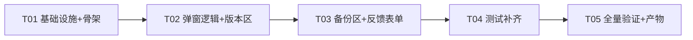

# 设置页面设计文档（docs/settings-design.md）

> 设计：架构师 高见远（Bob / software-architect-2-2-2） · 基线：main @ 2828296（v10.5.1） · 日期：2026-11-24
> 范围：仅研究与设计，不改代码。所有行号/函数名均已在当前 main 实地核对。

---

## 0. 调研结论（只读核实）

### 0.1 看板页 header / 工具条结构（设置入口落点）

看板页由 `renderBoard()`（src/js/03-app.js L42-76）全量绘制，结构为：

```
header.masthead
├─ .brand（eyebrow / h1 / tagline）
├─ .sp
└─ .mast-actions            ← 设置入口按钮放这里
   ├─ #installBtn（btn-ghost btn-sm，deferredPrompt 时才显示，L48）
   ├─ favoritesButton()（收藏夹，L49）
   ├─ 「导出备份」onclick=exportJSON()（L50）
   ├─ 「导入」→ #importFile hidden input（L51）
   ├─ 「清空」btn-danger（L52）
   └─ 「新建策划案」btn-primary（L53）
div.backup-tip#backupTip    ← 备份提示条（count>=30 时 show，L55、L73-74）
div.metrics（4 个 statPill）
div.toolbar（#boardSearch 搜索框 + 全部/进行中/已归档 seg）
div#boardGrid（六列看板，setBoardQuery 局部刷新）
```

**入口按钮设计**：在 `.mast-actions` 中 `favoritesButton()` 之后、「导出备份」之前插入：

```html
<button class="btn btn-ghost btn-sm" onclick="openSettings()">⚙ 设置</button>
```

- 与现有 ghost 按钮风格一致，不新增 CSS 类。
- `renderBoard()` 全量重绘会重建此按钮——但设置弹窗是**独立于 #app 的静态 DOM**（见 0.3），重绘不影响已打开的弹窗（与 nameModal 同一机制，已验证可行：nameModal 打开时触发 renderBoard 的场景下弹窗仍存活）。
- 搜索/筛选走 `refreshBoardGrid()`（L78-84）局部重绘 `#boardGrid`，完全不触碰 header——FB-1 局部重绘纪律不受影响。

### 0.2 现有散落配置的准确位置

| 配置 | 位置 | 关键函数 / 键 | 性质 |
|---|---|---|---|
| 姿势图库同步开关 | 状态：`shiseiSyncEnabled()`（04-output.js L291-293），键 `localStorage['wb_sf_shisei_sync']`（!=='0' 即开启）；控制 UI：`renderShiseiSyncStatus()`（L433-452）写入情绪板页 `<div id="shiseiSyncBox">`（03-app.js L313，renderMood 内） | `toggleShiseiSync()`（L453-462）、`startShiseiSync(true)`（L332 起）、`clearShiseiGallery()`（L463-472） | **真配置**（全局 localStorage 开关）+ 真实状态数据（`idb.getShiseiMeta('catalog')` + `idb.shiseiImgStats()`） |
| 标签词表 | **项目级**：`p.tagVocab`（02-core.js L42/47/70-84 merge/rename/remove），编辑入口在项目情绪板页 tagCloud（03-app.js L333-338：startRenameTag / delTagFromVocab） | 无全局词表 | **无全局配置**，设置页只能说明，不能聚合（见 3.2） |
| 备份提示条 | `renderBoard()` L55 + L74（backupItemCount>=30 显示）；导出/导入：`exportJSON()`（04-output.js L178-181）/ `importJSON(e)`（L189-206） | `backupItemCount(all)` | 只读状态 + 既有操作按钮 |
| PWA 安装 | `installApp()`（04-output.js L521），`deferredPrompt` 全局变量 | beforeinstallprompt 监听 L516-520 | 快捷入口 |
| AI 打标签 | `AI_TAGGING_ENABLED` 恒 false（04-output.js L239-264 注释「本期恒关闭」） | setAiConfig 等为接口预留 | **不存在真配置，不进设置页** |
| 数据清空 | `clearAll()`（04-output.js L227-237） | askConfirm 二次确认 | 留在看板，**不聚合**（避免危险操作双入口，见 7.2） |

关键复用安全性核实：
- `renderShiseiSyncStatus()` 开头 `if(!box) return`（L434）——设置弹窗打开时若情绪板 DOM 不存在（看板页），安全空转；设置页需自备独立状态渲染（不共享 DOM id，避免 modal 与页面 DOM 同时在文档中造成重复 id）。
- `clearShiseiGallery()` 末尾 `if(view.mode==='project'&&view.tab==='shots') renderShots(cur())`（L469）——从设置弹窗触发时 `view.mode==='board'`，条件不满足，安全跳过。
- `toggleShiseiSync()` / `startShiseiSync(true)` 只写 localStorage 与内存状态，不重绘页面级 DOM（除 renderShiseiSyncStatus 空转），可在设置弹窗内直接调用。

### 0.3 build / verify-build 现状与版本注入方案

- `scripts/build.mjs`：读 shell.html + styles.css + js/*.js（文件名排序拼接），替换 `<!--__STYLES__-->` / `<!--__JS__-->` 两个占位符，产物写 shotflow.html。
- `scripts/verify-build.mjs`：**重复实现了完全相同的拼接逻辑**（L13-24），对比产物逐字节一致。→ 两处逻辑必须同步改动，否则门禁误报。
- `scripts/sync-app.mjs`：仅做产物 → `shotflow-app/` 副本同步（`--check` 逐字节校验），不解析内容，**无需改动**；但产物变更后需重跑 `npm run sync`。
- `scripts/verify-version.mjs`：以 package.json version 为真源校验 lock/README/overview + SW CACHE 格式（`shotflow-v[\d-]+`），**不含产物内版本检查**。

**版本注入方案（确定稿）**：

1. **抽取共享组装模块 `scripts/assemble.mjs`**：导出 `assembleHtml({ injectVersion })`，包含现有拼接逻辑 + 新增版本注入。build.mjs 与 verify-build.mjs 都改为调用它——消除两份拷贝逻辑的漂移风险（本次改动后两文件各剩 ~10 行）。
2. **占位符**：src/js/01-data.js 中声明 `const APP_VERSION='__APP_VERSION__';`，shell.html 不加占位符（JS 内替换比 HTML 注入更利于逻辑测试直接读取）。assemble.mjs 把 `'__APP_VERSION__'`（含引号的完整字面量）替换为 `JSON.stringify(pkgVersion)`（如 `'10.5.1'`）。
3. **兼容性论证**：替换发生在 src→产物阶段，与 `<!--__STYLES__-->` 同一层；verify-build 用同一 assemble 函数计算期望产物 → 天然一致，**verify-build 无需额外适配**（只需改为调用 assemble）。logic.test.mjs 抽函数走产物内 `function name(` 文本匹配，不受常量声明影响。
4. **防漂移校验**：verify-version.mjs 增加一条——读取 src/js/01-data.js 中 `MODULE_VERSIONS.swCache` 常量，必须等于 shotflow-sw.js 的 `CACHE` 值（根目录与 shotflow-app/ 由 sync:check 保证一致）。

### 0.4 版本相关运行时事实

| 项 | 现状 | 设置页读取方式 |
|---|---|---|
| 应用版本 | package.json `10.5.1`；产物中此前**无处展示** | `APP_VERSION` 常量（构建注入） |
| SW 缓存版本 | `shotflow-sw.js` L1 `const CACHE='shotflow-v10-8'`（独立序列）；SW 无 message handler，**运行时无法从 SW 实例查询** | `MODULE_VERSIONS.swCache` 硬编码常量 + verify-version 防漂移校验 |
| IndexedDB 版本 | `indexedDB.open('shotflow',3)`（01-data.js L193——**实际是 3**，注释 L191 写「v4 起」指的是迁移语义，与 open 版本号不同） | 运行时 `idb.db.version`（打开后真实值），辅以常量表备注 |
| 各模块最后实质变更 | 见下表（git log 推导，revert 提交 c9fb528 为净零变更不计入） | `MODULE_VERSIONS` 常量表 |

`MODULE_VERSIONS`（放 src/js/01-data.js，硬编码，无运行时 git 依赖）：

| 模块 | 最后实质变更版本 | 依据（git log / CHANGELOG） |
|---|---|---|
| shell.html | v10.5.0 | 9d9c4ff P3 模块化拆分建立 |
| styles.css | v10.5.0 | 同上 |
| 01-data.js | v10.5.0 | 同上（此后无内容变更） |
| 02-core.js | v10.5.0 | 同上 |
| 03-app.js | v10.5.1 | 39f8b98 perf：分镜列表 O(N²)→O(N)；c9fb528 revert 为净零 |
| 04-output.js | v10.5.0 | 9d9c4ff 后无内容变更 |
| 05-boot.js | v10.5.0 | 同上 |
| Service Worker 缓存 | shotflow-v10-8（v10.5.0 bump） | CHANGELOG v10.5.0 |
| IndexedDB schema | 3（open 版本） | 01-data.js L193 |

> 拆分前的单文件历史（v1~v10.4.2）无法按模块归因，MODULE_VERSIONS 只覆盖「src/ 模块化之后」的变更，表内附说明文案。

---

## 1. 设置弹窗形态与信息架构

- **形态**：应用级弹窗 `settingsModal`（modal-mask + modal 结构，复用 docModal 的 sticky bar 模式），**不是第 8 个页签**、不占用 `view.mode`。入口在看板页 mast-actions。
- **DOM 位置（关键）**：shell.html 中 `#settingsModal` 必须插在 `#confirmModal` **之前**（confirmModal 目前是文档流中较早的弹窗）。原因：所有 modal-mask 均为 `z-index:300`（styles.css L301），后出现的 DOM 在同 z-index 下覆盖先出现的；`clearShiseiGallery()` 会在设置弹窗之上唤起 askConfirm——confirmModal 在 DOM 序上靠后才能正确盖住设置弹窗。settingsModal 放在 docModal 之后、confirmModal 之前的位置。
- **信息架构**（四区，设置弹窗内用 `<details>` / card 分节，沿用 src-panel / card 现有样式）：

```
settingsModal
├─ settings-bar（sticky，复用 .doc-bar 样式）：标题「设置」+ 关闭按钮
├─ ① 版本信息（只读）
│   ├─ 大字：应用版本 v{APP_VERSION}
│   ├─ 行：SW 缓存 / IndexedDB schema / 数据规模（项目数·图片数）
│   └─ <details> 各代码模块最后实质变更（MODULE_VERSIONS 表）
├─ ② 模块配置
│   ├─ 姿势图库同步：开关（暂停/恢复）+ 状态行（已同步 N 张 · 约 X MB）
│   └─ PWA 安装：安装到桌面按钮（无 deferredPrompt 时显示「已安装/不可用」）
├─ ③ 数据与备份
│   ├─ 备份提示（backupItemCount>=30 时文案，与看板 backupTip 同源）
│   ├─ 「导出备份」exportJSON() / 「导入」#importFile（独立 id，见 2.3）
│   └─ 说明：标签词表为项目级数据，在各项目「情绪板」页编辑（纯文案，无跳转）
└─ ④ 反馈
    ├─ 类型选择（Bug / 功能建议 / 其他）
    ├─ 标题 / 描述
    ├─ 环境信息预览（自动生成，只读折叠）
    ├─ 「提交反馈」（Web3Forms 页面内 POST，access key 静默还原）+ 「复制反馈内容」（兜底）
    └─ 隐私说明一行
```

---

## 2. 配置项清单（逐项对号，不发明配置）

### 2.1 真配置（可读写）

| # | 配置项 | 对应现有实现 | 设置页行为 |
|---|---|---|---|
| C1 | 姿势图库自动同步 开/关 | `shiseiSyncEnabled()` / `toggleShiseiSync()`，localStorage `wb_sf_shisei_sync` | 开关 UI；切换后调用 `toggleShiseiSync()` 并刷新设置页状态行（自备 `renderSettingsShisei()`，不依赖 #shiseiSyncBox） |
| C2 | 姿势图库 立即同步 / 清除本机图库 | `startShiseiSync(true)` / `clearShiseiGallery()`（内部 askConfirm 叠层安全，见 0.2） | 设置页内提供按钮；状态行复用 `idb.getShiseiMeta('catalog')` + `idb.shiseiImgStats()` |

> 其余一切（分镜默认时长、机位/光线固定选项、AI 打标签、主题色等）**当前不存在可改配置**，一律不进设置页。`AI_TAGGING_ENABLED` 是代码级预留常量（恒 false），不做成 UI 开关——本期它没有任何生效路径。

### 2.2 只读展示

| # | 项 | 来源 |
|---|---|---|
| R1 | 应用版本 | `APP_VERSION`（构建注入） |
| R2 | SW 缓存版本 | `MODULE_VERSIONS.swCache` |
| R3 | IndexedDB schema 版本 | 运行时 `idb.db.version` |
| R4 | 数据规模 | `loadP().length` 项目数 + `Object.keys(imgCache).length` 已载图片数（轻量，不遍历 idb 全库） |
| R5 | 模块版本表 | `MODULE_VERSIONS` |
| R6 | 备份提醒状态 | `backupItemCount(loadP())>=30` |

### 2.3 快捷入口（复用既有函数，不复制逻辑）

| # | 项 | 行为 |
|---|---|---|
| J1 | 导出备份 | 直接调 `exportJSON()`（04-output.js L178） |
| J2 | 导入 | 设置弹窗内自备 `<input type="file" id="settingsImportFile">`（**独立 id**：看板页的 #importFile 仍在文档中，不能重 id），onchange 同样调 `importJSON(event)`（函数按 event.target 取文件，天然兼容） |
| J3 | 安装到桌面 | `installApp()`；`deferredPrompt` 为空时按钮置灰显示「已安装或浏览器不支持」 |
| J4 | 标签词表说明 | 纯文案：指向各项目「情绪板」页（无全局词表，无法跳转到具体项目，见 7.2 待确认①） |

### 2.4 明确不进设置页的项（防蔓延）

- 「清空数据」（clearAll）：危险操作保持看板唯一入口。
- 文档导出 / 提案输出：项目级功能。
- 姿势图库分类浏览（view.poseCat）：项目情绪板上下文。
- SW 缓存强制刷新：无既有实现，不做（toast「发现新版本」已有刷新路径）。

---

## 3. 版本信息区块设计

```
┌ 设置 · 版本信息 ────────────────────────────┐
│  v10.5.1   （大字，APP_VERSION）             │
│  Service Worker 缓存：shotflow-v10-8        │
│  数据结构版本（IndexedDB）：3               │
│  数据规模：12 个策划案 · 86 张图片          │
│  ▸ 各代码模块最后实质变更（点开折叠表）      │
│     shell.html / styles.css   v10.5.0       │
│     01-data.js（数据层）       v10.5.0       │
│     02-core.js（核心纯函数）   v10.5.0       │
│     03-app.js（页面与交互）    v10.5.1       │
│     04-output.js（输出与后台） v10.5.0       │
│     05-boot.js（启动）         v10.5.0       │
│     （模块版本自 v10.5.0 源码模块化起记录）  │
└─────────────────────────────────────────────┘
```

- `MODULE_VERSIONS` 结构：`{shell, styles, data, core, app, output, boot, swCache, dbSchema, since:'v10.5.0'}`，集中在 01-data.js 顶部（APP_VERSION 旁），反馈环境信息直接引用。
- 发布纪律：每次发版 bump package.json 时，同步检查 MODULE_VERSIONS 中实质变更过的模块行（写入 CONTRIBUTING.md 检查单，T05 一并落文档）。

---

## 4. 反馈表单设计

### 4.1 字段

| 字段 | 控件 | 约束 |
|---|---|---|
| 类型 | seg 三选（Bug / 功能建议 / 其他） | 默认 Bug |
| 标题 | input | maxlength 80，必填（空则 toast 提示） |
| 描述 | textarea | maxlength 4000，非强制 |
| 环境信息 | 只读 `<details>`，自动生成 | 见 4.2 |

### 4.2 环境信息（`buildFeedbackEnv()` 纯函数，便于逻辑测试）

```
版本：v10.5.1（SW 缓存 shotflow-v10-8 / 数据结构 3）
环境：Mozilla/5.0 …（navigator.userAgent）
平台：Win32 · 语言 zh-CN · 屏幕 2560×1440（devicePixelRatio 1）
状态：IndexedDB 可用 / 剪贴板 API 可用 / 离线
项目数：12
```

来源全部为只读 API：APP_VERSION、MODULE_VERSIONS、navigator.userAgent/platform/language、screen.width/height、!!window.indexedDB、navigator.clipboard 可用性、navigator.onLine、loadP().length。

### 4.3 提交通道

**主通道：Web3Forms 页面内提交（v10.7 管理员决定：不跳转、不拉起邮件客户端）**

- 表单服务 access key 以**双层混淆常量**（`FB_KEY_A` / `FB_KEY_B`，01-data.js）存于源码，运行时由 `fbDecodeKey()` 还原；源码 / 配置 / 构建产物 / 界面 / 日志 / 测试**均不出现明文**，也不写入 DOM / title / tooltip / console。
- `fbDecodeKey()` 失败或结果不是 36 字符 → 返回空串；`buildFeedbackPayload()` 返回 `null`；`submitFeedback()` 只 toast「反馈提交暂不可用，请使用『复制反馈内容』」并 return，**不泄露任何解码中间值**。

```
fbDecodeKey()                              → 纯函数（65 字符表置换解码，vm 可抽取）
buildFeedbackPayload(type,title,body,env)  → 纯函数，返回 null 或
  { access_key, subject: '[类型] 标题', from_name: '瞬刻摄影工作台',
    message: body + '\n\n---\n' + envText }        // message > 20000 字符截断并追加提示
```

- 提交按钮 `fetch('https://api.web3forms.com/submit', {method:'POST', headers:{'Content-Type':'application/json','Accept':'application/json'}, body: JSON.stringify(payload)})`，页面不跳转；这是应用除姿势图库同步之外的唯一对外提交出口。
- 三态：成功（`res.ok && data.success`）→「反馈已提交，感谢！」并清空表单；HTTP 非 2xx / `success:false` →「提交失败，请使用『复制反馈内容』」；异常 →「网络异常，请使用『复制反馈内容』」。提交期间按钮 `disabled` + 「提交中…」，结束恢复「提交反馈」。

**兜底通道：复制反馈内容**

- `copyFeedbackText()`：组装纯文本（标题+类型+描述+环境信息）→ `navigator.clipboard.writeText` → toast「已复制反馈内容，可粘贴到邮件正文发给维护者」。
- 降级链：clipboard API 不可用（file:// 或非安全上下文）→ 隐藏 textarea 选中 + `document.execCommand('copy')` → 仍失败 toast 提示手动复制（弹窗内文本可选中）。

**隐私说明（弹窗内固定文案）**：反馈仅包含你填写的文字与上列浏览器环境信息，**不包含任何策划案内容、图片或数据文件**。

---

## 5. 与现有功能的隔离设计

1. **不触碰渲染主循环**：`openSettings()/closeSettings()` 只做 `classList.toggle('show')` + 弹窗内容填充；不改 `view`、不调 `renderBoard()/renderProject()`。弹窗打开期间看板/项目页 DOM 原样保留。
2. **FB-1 局部重绘纪律适用**：反馈表单输入用 `oninput` 存入弹窗内临时状态（模块级 `settingsDraft` 或直接读 DOM），**不触发任何全局重绘**；弹窗关闭即弃。
3. **弹窗叠层**：settingsModal DOM 位置在 confirmModal 之前（见 1），askConfirm / nameModal 可正常盖在其上；Esc 关闭链（04-output.js L532-541 keydown）在 `shown('confirmModal')` 与 `shown('nameModal')` 判断之后、`closeDoc()` 之前插入 `if(shown('settingsModal')){closeSettings();return;}`——保持「后开的先关」顺序。
4. **数据安全**：设置弹窗唯一写操作是 `localStorage['wb_sf_shisei_sync']`（经既有 toggleShiseiSync），不经 `updateCur` 守卫，不触碰项目数据；导入走既有 askConfirm 确认链。
5. **性能**：打开弹窗不做全库 idb 扫描；shiseiImgStats 游标统计为既有实现（情绪板已在用），仅弹窗打开时调用一次。
6. **PoseWear 禁令**：本设计零引用 pw*/posewear（已自检：全文仅 shisei——管理员已确认 shisei 属于 main 合法内容）。

---

## 6. 任务列表（按依赖排序）

改动文件区域汇总：`scripts/{assemble.mjs新增,build.mjs,verify-build.mjs,verify-version.mjs}`、`src/shell.html`、`src/styles.css`、`src/js/{01-data.js,04-output.js,新增06-settings.js}`、`tests/{logic.test.mjs,e2e/app.spec.js}`、`CONTRIBUTING.md`。

| ID | 任务 | 文件 | 依赖 | 优先级 |
|---|---|---|---|---|
| T01 | 版本注入基础设施 + 设置弹窗骨架：新增 scripts/assemble.mjs（共享组装 + `__APP_VERSION__` 注入）；build.mjs/verify-build.mjs 改调 assemble；verify-version.mjs 加 swCache 防漂移校验；01-data.js 加 `APP_VERSION`、`MODULE_VERSIONS` 常量（v10.7 反馈通道定稿为 Web3Forms：新增 `FB_KEY_A/B` 混淆常量，移除原公开仓库与邮件方案常量）；shell.html 加 #settingsModal 静态骨架（置于 confirmModal 之前，含 sticky bar）；styles.css 加 settings 弹窗所需少量样式（复用 doc-bar/card，预计 <30 行）；04-output.js Esc 链加 settingsModal | scripts/*、src/shell.html、src/styles.css、src/js/01-data.js、src/js/04-output.js | — | P0 |
| T02 | 设置弹窗打开/关闭 + 版本信息区 + 配置区：新增 src/js/06-settings.js（openSettings/closeSettings/renderSettings 版本区/C1 C2 J3、renderSettingsShisei）；03-app.js renderBoard mast-actions 插「⚙ 设置」按钮 | src/js/06-settings.js（新）、src/js/03-app.js | T01 | P0 |
| T03 | 数据与备份区 + 反馈表单：06-settings.js 补 R6/J1/J2（settingsImportFile 独立 id）与 buildFeedbackEnv/buildFeedbackUrl/copyFeedbackText/提交按钮/隐私文案；styles.css 表单样式 | src/js/06-settings.js、src/styles.css | T02 | P1 |
| T04 | 测试补齐：logic.test.mjs 抽取 buildFeedbackUrl/buildFeedbackEnv 校验 URL 拼接/截断/环境字段；e2e/app.spec.js 增用例（打开设置→关闭→Esc；同步开关切换后 localStorage 变化；反馈 URL 参数正确）；CONTRIBUTING.md 发版检查单加「MODULE_VERSIONS 同步」 | tests/logic.test.mjs、tests/e2e/app.spec.js、CONTRIBUTING.md | T03 | P1 |
| T05 | 全量验证 + 构建产物 + 副本同步：npm run build / verify:build / verify:version / sync / sync:check / lint / test 全绿；perf 门禁复核；浏览器手工清单（§7） | shotflow.html、shotflow-app/（产物与副本） | T04 | P0 |

依赖图：



---

## 7. 验证要点

### 7.1 自动化（全部既有门禁必须保持绿）

- `npm run build` → `npm run verify:build`（改用 assemble 后逐字节一致）
- `npm run verify:version`（含新增 swCache 校验）
- `npm run sync:check`（产物变更后必须先 sync）
- `npm run lint` / `npm run format:check`
- `npm run test:logic`（99 项 + 新增反馈函数项）
- `npm run test:e2e`（4 项 + 新增设置弹窗项）
- `npm run test:perf`（2000 分镜 < 50ms 门禁不受影响——设置代码不进渲染热路径）

### 7.2 浏览器手工清单

1. 看板页点「⚙ 设置」→ 弹窗打开，看板底层不重绘、搜索框焦点不丢（FB-1）。
2. 版本区显示 v10.5.1 / shotflow-v10-8 / 数据结构 3，与 package.json、shotflow-sw.js 一致。
3. 姿势图库开关：关 → 弹窗状态「已暂停」，去情绪板素材来源验证状态一致；开 → 恢复。
4. 弹窗内「清除图库」→ confirm 弹层正确盖在设置弹窗上；Esc 先关 confirm 再关设置。
5. 导出备份/导入（经设置弹窗）与看板入口行为一致（含覆盖确认弹层）。
6. 反馈表单：空标题提交被拦截；Bug 类型走 Web3Forms 页面内提交（access key 静默还原，标题/正文/环境信息进请求体，成功清空表单）；失败或断网时复制按钮兜底可用。
7. Esc / 遮罩点击关闭设置弹窗；关闭后再打开内容重置。
8. file:// 双击打开产物：设置弹窗可用（clipboard 降级生效），无 console 报错。
9. PWA 安装场景：deferredPrompt 存在时设置内安装按钮可用。
10. 移动端宽度（≤700px）弹窗布局不溢出（.modal 已有 max-height:88vh + overflow:auto）。

---

## 8. 风险与待确认项（请 team-lead 转管理员裁决）

| # | 事项 | 说明与建议 | 需要决定 |
|---|---|---|---|
| ① | IndexedDB 版本号展示 | 代码实际 `open('shotflow',3)`，但 01-data.js L191 注释写「v4」。设置页按运行时 `idb.db.version`（=3）展示。是否顺带统一注释表述（不改 open 版本），由管理员定 | 是否修注释 |
| ② | SW 缓存版本运行时只读常量 | SW 无 message handler，无法实时查询 CACHE。方案用 MODULE_VERSIONS 硬编码 + verify-version 防漂移校验。若希望真·运行时读取，需给 SW 加 postMessage（本期不做，可作为后续项） | 接受常量方案？ |
| ③ | Web3Forms 请求体大小上限 | JSON 可达数 MB；`message` 超 20000 字符自动截断 + 复制兜底。管理员若希望更稳，后续可加「下载反馈为 .md 文件」 | 接受截断策略？ |
| ④ | 版本号是否随设置页发布 bump | 新功能按惯例应 bump 到 10.6.0，并同步 README/overview（verify-version 会强制）+ CHANGELOG + MODULE_VERSIONS（03-app 等将变 v10.6.0）。发布节奏由管理员定 | bump 与否 |
| ⑤ | 新增 06-settings.js 文件 | 违反「五文件」现状但语义清晰；同一 `<script>` 块内函数声明提升，boot 执行顺序无影响。若管理员坚持五文件，可并入 04-output.js 尾部（约 +250 行） | 文件结构偏好 |
| ⑥ | 标签词表无全局编辑入口 | 词表是项目级（p.tagVocab），设置页只放说明文案。若管理员想要「跨项目全局词表」，属新需求需另立项 | 是否接受 |
| ⑦ | 反馈是否需要登录/邮箱兜底 | 当前公开仓库允许匿名网页开 issue；「发邮件」路线因无邮箱地址已按指示排除 | 确认排除邮件 |
