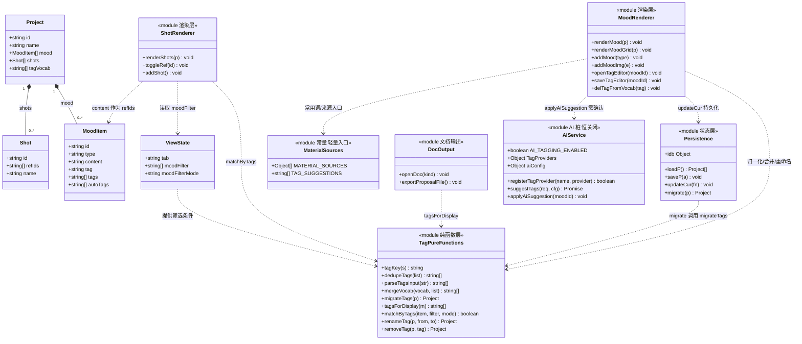
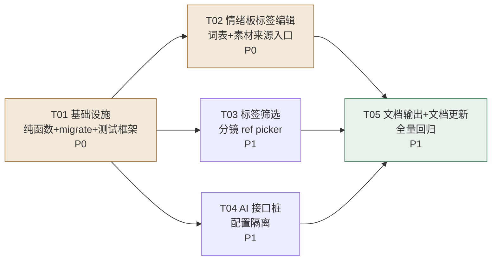

# Stillmark 素材标签系统 · 系统设计与任务分解

> 架构师：高见远（Gao）｜基线：`shotflow.html` v5 @ `d5717db`（1369 行单文件全内联）｜状态：设计定稿，待主理人确认「待明确事项」
>
> 本文所有行号均以 HEAD `d5717db` 为准；代码插入后行号顺延，以函数名定位为准。

## 0. 需求对齐摘要（已采纳，不再论证）

| 项 | 定稿结论 | 落地位置 |
|---|---|---|
| 「动作区域」 | 不新增页签；指情绪板图片区 + 分镜 ref picker；「动作」作为标签维度 | `renderMood` / `renderShots` 空态文案 + `TAG_SUGGESTIONS` 动作词组 |
| 标签模型 | mood 项统一 `tags:string[]`，旧 `tag` 只读兼容；项目级 `tagVocab` | `migrateTags` / `migrate` |
| 归一化 | trim + NFKC 全半角 + 大小写 + 空白折叠后比较；保留首次显示形式 | `tagKey` / `dedupeTags` |
| AI 接口 | 只设计不实现；`AI_TAGGING_ENABLED=false`；零网络；失败降级 toast；不覆盖手工标签；建议需确认；另存 `autoTags`；可插拔注册表 | `suggestTags` / `TagProviders` / `applyAiSuggestion` |
| 素材仓库 | 本期不打包任何外部素材；轻量外链入口 + 版权说明 | `MATERIAL_SOURCES` + 情绪板底部 `<details>` |
| 不做 | AI 实际调用、以图搜图/向量检索、云同步、标签层级/颜色、密钥入库、内嵌外部素材、改 `refIds` 或 800px 压缩策略、人脸识别/OCR | 全文禁止出现相关实现 |

---

# Part A：系统设计

## 1. 实现方案总述

### 1.1 单文件内的三层组织

`shotflow.html` 是单文件全内联结构（`<style>` 14–273 行、`<script>` 304–1367 行），零依赖、无构建。本次改造**不引入任何运行时文件、框架或打包步骤**，而是在现有 `<script>` 内按既有分层追加代码，保持与 v5 完全一致的组织方式：

| 层 | 现有位置 | 本次新增/改动 | 约束 |
|---|---|---|---|
| **纯函数层** | 数据层 305–322（`todayStr`/`uid`/`esc`）、时间函数 883–928 | 在 `migrate`（435）之前插入标签纯函数块（约 60 行） | 全部写成 `function name(){}` 具名声明；不引用 `document`/`window`/`idb`/`view`；只用 `String/Array/Object/Set/JSON` 等内置，保证 `tests/logic.test.mjs` 的 `vm` 抽取可执行 |
| **状态层** | `view`（430）、`cur`（431）、`updateCur`（432）、`loadP/saveP`（451–458） | `view` 增加会话内筛选字段；`aiConfig` 独立内存变量 + `sessionStorage`；所有持久化仍只走 `updateCur` | 禁止直接写 `projectsCache`；禁止为标签新增 IndexedDB store；筛选状态不入库、不导出 |
| **渲染层** | `renderProject`（628–673）总绘制 `tabBody`，各 `render*` 子函数 | 重写 `renderMood`、新增 `renderMoodGrid`、改 `renderShots` 的 ref picker；文档输出小改 | 除筛选输入外仍走 `renderProject()` 全量重绘；筛选局部重绘只替换 `#tagCloud` / `#moodGrid`，避免输入框丢焦点 |

### 1.2 核心技术难点与对策

1. **向后兼容不能破坏 22 项既有测试**
   `tests/logic.test.mjs:17-19` 用 `vm.createContext({console,Date,Math,String,Number,Array,Object,JSON,RegExp})` 抽取具名函数执行。`migrate` 在测试输入里拿到的是没有 `mood` 的对象（`logic.test.mjs:62`），因此 `migrateTags` 必须容忍字段缺失；新增纯函数用到 `Set`，**必须在测试 ctx 第 17 行注入 `Set`**（这是唯一的测试框架改动，不影响既有断言）。

2. **异步上传时读取输入框的时序**
   现有 `addMoodImg`（718–732）在 `FileReader.onload → img.onload → await idb.put` 之后才读 `document.getElementById('m_tag').value`。改造时把标签字符串在 `addMoodImg(e)` 同步入口先读出为局部变量 `tagInput`，再传入异步回调，避免用户在压缩期间切页导致空引用。压缩策略（`800px` / `image/jpeg` / `.72`）与 `idb.put` 写入方式**一行不改**。

3. **筛选与重绘的焦点冲突**
   现有 `s_filter`（757 行）逐字符 `renderShots(cur())` 会丢焦点。标签筛选不复制这个缺陷：`renderMood` 骨架只建一次，筛选输入保持 DOM 常驻，仅由 `renderMoodGrid(p)` 替换两个网格容器。

4. **AI 桩做到"可插拔但绝对零网络"**
   双重门控：编译期常量 `AI_TAGGING_ENABLED=false`（本期恒 false）+ 运行期注册表 `TagProviders` 默认空。开关关闭时直接返回空对象，连注册表都不查；即使有人在运行期把开关改 true，没有 provider 也会抛 `AI_TAGGING_PROVIDER_MISSING` 而非发请求。`aiConfig` 只存内存/`sessionStorage`，不进 `loadP/saveP`、不进任何导出。

5. **删标签不破坏分镜引用**
   `Shot.refIds` 存的是 `mood.content`（IndexedDB key），与标签完全解耦。`removeTag` / `renameTag` 只改 `m.tags` / `p.tagVocab`，绝不触碰 `m.content`、`m.id`、`refIds`。只有 `delMood` 才断引用（现有行为不变）。

### 1.3 架构模式

沿用现有 **事件驱动 + 全量重绘（MVC-lite）**：`view` 为 Controller 状态，`loadP()/saveP()` 为 Model 入口，`renderProject()` 为 View 入口。标签系统不引入新范式，工程师可照抄 `addTodo/delTodo`（1054–1060）等既有函数的写法。

---

## 2. 文件清单

### 2.1 `shotflow.html`（唯一运行时改动文件）

| 序 | 区域（HEAD 行号） | 改动类型 | 具体内容 |
|---|---|---|---|
| A | CSS `.tag`/`.chip` 之后（45–52） | 追加类 | `.tagchip`、`.tag-cloud`、`.tag-filter`、`.tag-editor`、`.ref-tag`、`.src-note`、`.src-lic`（复用 `--accent*` / `--line*` 变量，不新增色板） |
| B | CSS mood 区之后（127–143） | 追加类 | `.mfoot .tagchip` 换行布局、`.tag-cloud` chip 的 hover 操作位、`.tag-rename` 内联输入框、`<details>` 来源区样式 |
| C | 数据层常量（306–309 后） | 新增 | `AI_TAGGING_ENABLED`、`TagProviders`、`aiConfig`、`MATERIAL_SOURCES`、`TAG_SUGGESTIONS` |
| D | `migrate`（435–448） | 修改 | 在第 447 行 `return p` 前插入 `migrateTags(p)`；一行改动，幂等 |
| E | `migrate` 之前（434 行处） | 新增 | 纯函数块：`tagKey` / `dedupeTags` / `parseTagsInput` / `mergeVocab` / `migrateTags` / `tagsForDisplay` / `matchByTags` / `renameTag` / `removeTag` |
| F | `view`（430） | 修改 | 增加 `moodFilter:[]`、`moodFilterMode:'any'` |
| G | `renderMood`（694–711） | 重写 | 骨架 + 标签输入（逗号分隔）+ 词表云 + `#moodGrid` + 素材来源 `<details>`；末尾调用 `renderMoodGrid(p)` |
| H | 新增（紧随 `renderMood`） | 新增 | `renderMoodGrid(p)`、`openTagEditor(moodId)`、`saveTagEditor(moodId)`、`startRenameTag(from)`、`commitRenameTag(from)`、`delTagFromVocab(tag)`、`clearMoodFilter()` |
| I | `addMood`（712–717） | 修改 | `parseTagsInput(gv('m_tag'))` → 写 `tags` + `tag`（兼容）+ `tagVocab=mergeVocab(...)` |
| J | `addMoodImg`（718–732） | 修改 | 同步读 tag 输入 → 异步回调里写 `tags`/`tag`/`tagVocab`；压缩与 IDB 写入不动 |
| K | `delMood`（733） | 不改 | 保持"删项才断引用"；不自动清理词表（避免误删可复用词），由用户显式 `delTagFromVocab` 清理 |
| L | `renderShots`（738–774） | 修改 | 739 行 `moodImgs` 增加 `matchByTags` 过滤；753–756 ref picker 每项加 `.ref-tag` 与空态新文案；`selRefs` / `addShot` 不改 |
| M | `openDoc`（1159–1211） | 修改 | 仅 1181 行：当 `kind==='manual'` 时文字项尾部追加 `tagsForDisplay(m).map(t=>'#'+esc(t))`；提案分支视觉不变 |
| N | `exportProposalFile`（1215–1247） | 不改 | 对外文档保持干净，不显示内部标签；不写 AI 配置 |
| O | 新增（AI 接口区，建议放在 `toast` 之前 1328 行处） | 新增 | `registerTagProvider`、`suggestTags`、`applyAiSuggestion`、`setAiConfig`；桩内零 `fetch`/`XMLHttpRequest` |
| P | `collectImages`（1255–1262）/ `applyImport`（1297–1312） | 不改 | 标签是项目 JSON 内字段，随既有导出/导入自动流转；`migrate` 已挂钩故导入旧数据自动补标签 |

> 运行时文件总数不变：`shotflow.html` 与 `shotflow-app/shotflow.html` 为同一份内容（改完 `cp` 同步，遵循 README:87 的既定流程）。`shotflow-sw.js` 缓存版本按既有发布流程递增即可，非本设计强制项。

### 2.2 `tests/logic.test.mjs`（80 行 → 约 130 行）

| 序 | 行号 | 改动 |
|---|---|---|
| 1 | 第 17 行 | `vm.createContext({..., RegExp, Set})` —— 注入 `Set`，唯一框架改动 |
| 2 | 第 18 行 | 抽取列表追加 9 个纯函数名：`tagKey,dedupeTags,parseTagsInput,mergeVocab,migrateTags,matchByTags,renameTag,removeTag,tagsForDisplay` |
| 3 | 第 18 行后 | 追加 `vm.runInContext(fn('suggestTags'), ctx)` 并断言默认关闭路径返回空、零网络 |
| 4 | 第 62–64 行后 | 追加约 14 项标签断言；原 `migrate` 断言保持原样不动 |
| 5 | 末尾 | `RESULT` 计数由 22 增至 36（22 原有 + 14 新增），`process.exit(fail?1:0)` 不变 |

### 2.3 `README.md`（142 行）

- **第 37 行「情绪板」表格行**：补充「图片/文字/色彩均可打多标签（逗号分隔），支持按标签筛选与词表重命名/删除」。
- **第 38 行「分镜」表格行**：补充「参考图选择器支持按情绪板标签筛选；动作/景别/光线等词可快捷选取」。
- **第 103–115 行「推荐使用流程」第 3、5 步**：第 3 步加「上传时给素材打标签」，第 5 步加「按标签快速挑参考图」。
- **第 126–132 行「迭代记录」**：新增 **v6** 条目（标签系统 + AI 接口预留 + 素材来源入口），置于 v5 之上。
- **第 133–139 行「已知限制」**：加一条「AI 自动打标签为接口预留，当前默认关闭、不发起任何网络请求；外部素材仅提供链接，不内置」。

### 2.4 `overview.md`（40 行）

- **第 4 行版本**：改为 `v6`，测试数 36。
- **第 12 行 mood 数据模型**：`tag` 旁补 `tags:string[]`；project 补 `tagVocab:string[]`。
- **第 25–36 行「关键实现」**：新增一条「标签体系：`tagKey` 归一化 / `migrateTags` 幂等迁移 / `matchByTags` any|all 筛选 / `suggestTags` 可插拔桩（恒关闭、零网络）」。
- **第 34 行测试描述**：22 → 36 项。

### 2.5 是否需要新增文件

**运行时：否。** 仅新增 3 份设计文档（`docs/system_design.md`、`docs/class-diagram.mermaid`、`docs/sequence-diagram.mermaid`），不参与程序加载、不影响 PWA 缓存。不新增 CSS/JS 外链文件，不新增素材图片文件。

---

## 3. 数据结构与接口

### 3.1 精确数据结构（TypeScript-like）

```ts
type MoodType = 'text' | 'color' | 'image';

interface MoodItem {
  id: string;            // uid()，卡片与编辑器主键，永不因标签操作改变
  type: MoodType;
  content: string;       // image → IndexedDB key；color → '#RRGGBB'；text → 文本正文
  tag: string;           // [兼容·只读] 旧单值标签；migrateTags 只读取不删除
                         // 新写路径仍写 tags[0]||''，保证旧文档模板与旧导出可显示
  tags: string[];        // 新增：归一化去重后的标签数组，保留首次出现显示形式
  autoTags?: string[];   // 预留：AI 建议但未确认的候选词；本期恒不存在（migrate 不预置）
}

interface Project {
  // ...既有字段 id/name/client/studio/status/shootDate/location/lat/lng/v3/createdAt/updatedAt 全部不变
  concept: { theme, model, style, audience, usage, note };
  mood: MoodItem[];
  tagVocab: string[];    // 新增：项目级词表，元素为首次出现的显示形式，顺序=首次出现顺序（不做字典序）
  scenes: Scene[]; shots: Shot[]; schedule: Node[];
  items: Item[]; budget: Budget[]; notes: Note[]; todos: Todo[];
}

interface Shot {
  id: string; name: string; date: string; slot: string;
  duration: number; sceneId: string; refIds: string[]; // refIds 机制完全不变
  note: string; done: boolean; ord: number;
}

interface ViewState {    // 会话内，不持久化、不导出
  mode: 'board' | 'project'; pid: string | null; tab: string;
  shotFilter: string; boardQuery: string; boardScope: string;
  moodFilter: string[];        // 新增：当前筛选标签（语义为 tagKey 归一化后的 key 列表）
  moodFilterMode: 'any'|'all'; // 新增：多标签匹配模式，默认 'any'
}

interface AiConfig {     // 仅内存 + sessionStorage['sf_ai_cfg_v1']，绝不入库/导出
  enabled: boolean; endpoint: string; apiKey: string; model: string; timeoutMs: number;
}

interface TagSuggestReq { blob: Blob; mime: string; maxTags?: number; vocab?: string[] }
interface TagSuggestRes { tags: string[]; confidence?: number; source: 'ai' }
```

### 3.2 新增纯函数签名与语义

全部位于 `migrate` 之前，具名 `function` 声明，无副作用（除显式传入的 `p` 外不改外部状态）。

| 函数 | 签名 | 语义 |
|---|---|---|
| `tagKey` | `function tagKey(s): string` | `String(s??'').normalize('NFKC').trim().toLocaleLowerCase('en-US').replace(/\s+/g,' ')`。用于**比较**，不用于显示。允许词内空格（`golden hour` 是一个标签），只折叠连续空白。空串返回 `''`。 |
| `dedupeTags` | `function dedupeTags(list): string[]` | 输入任意值（非数组→`[]`）；丢弃空串与归一化后空串；按 `tagKey` 去重；**保留首次出现的显示形式**；返回新数组，不改入参。 |
| `parseTagsInput` | `function parseTagsInput(str): string[]` | `dedupeTags(String(str??'').split(/[,，;；]+/))`。分隔符仅逗号/分号（中英文），**空格不拆分**，以支持 `golden hour` / `侧 逆 光` 类输入。UI placeholder 明确提示。 |
| `mergeVocab` | `function mergeVocab(vocab, list): string[]` | `dedupeTags([...(vocab\|\|[]), ...(list\|\|[])])`。不可变；用于词表与素材标签的合并去重。 |
| `migrateTags` | `function migrateTags(p): Project` | 幂等迁移：<br>1) `p.tagVocab=dedupeTags(p.tagVocab)`；<br>2) 每个 mood 项：非数组 `tags` → `m.tag ? [m.tag] : []` 后 `dedupeTags`；已有数组也再 `dedupeTags`；<br>3) `p.tagVocab=mergeVocab(p.tagVocab, p.mood.flatMap(m=>m.tags\|\|[]))`；<br>4) **不删除 `m.tag`**，不创建 `autoTags`。<br>缺失 `mood`/`tagVocab` 时按空数组处理。 |
| `tagsForDisplay` | `function tagsForDisplay(m): string[]` | `m.tags?.length ? m.tags : (m.tag ? [m.tag] : [])`。渲染与文档输出的唯一读取口，保证旧数据不空白。 |
| `matchByTags` | `function matchByTags(item, filter, mode): boolean` | `filter` 为空/`[]` → `true`；将 `filter` 各元素过 `tagKey`，与 `tagsForDisplay(item)` 的 `tagKey` 比较；`mode==='all'` 需全部命中，其余按 `'any'`（命中任一）。不修改任何入参。 |
| `renameTag` | `function renameTag(p, from, to): Project` | 就地改 `p`：对**所有** mood 项（text/color/image 一视同仁），把 `tagKey(t)===tagKey(from)` 的标签显示形式替换为 `to.trim()`；随后 `p.tagVocab=mergeVocab(dedupeTags(p.tagVocab.map(t=>tagKey(t)===fk?to:t)), [to])` 保证词表同步且合并同名。`from`/`to` 归一化后为空则原样返回。**不动 `content`/`refIds`**。 |
| `removeTag` | `function removeTag(p, tag): Project` | 就地改 `p`：所有 mood 项剔除 `tagKey(t)===tagKey(tag)` 的标签；`p.tagVocab` 同样剔除；`tag` 单值字段若归一化命中则清空为 `''`。**不动图片 key 与 `refIds`**。 |

> 依赖内置：`Set`（`dedupeTags`/`mergeVocab`）、`Array.prototype.flatMap`（`migrateTags`）、`String.prototype.normalize`（`tagKey`）。Node 与所有目标浏览器均支持；测试 ctx 需补 `Set`（见 2.2）。

### 3.3 AI 接口桩（`suggestTags` 精确写法）

放在 `toast` 之前（约 1328 行），**不得出现 `fetch` / `XMLHttpRequest` / `axios` / `import(` 任何字样**：

```js
/* ===== AI 打标签：接口预留（本期恒关闭，零网络） ===== */
const AI_TAGGING_ENABLED = false;                 // 编译期总开关，本期不改
const TagProviders = Object.create(null);         // 注册表：{ [name]: { suggest(req,cfg):Promise<TagSuggestRes> } }
let aiConfig = (()=>{                             // 仅会话配置，不入库不导出
  const def={enabled:false,endpoint:'',apiKey:'',model:'',timeoutMs:8000};
  try{ return Object.assign(def, JSON.parse(sessionStorage.getItem('sf_ai_cfg_v1'))||{}); }
  catch(e){ return def; }
})();
function setAiConfig(k,v){
  aiConfig[k]=v;
  try{ sessionStorage.setItem('sf_ai_cfg_v1', JSON.stringify(aiConfig)); }catch(e){}
}
function registerTagProvider(name, provider){
  const n=String(name||'').trim();
  if(!n || !provider || typeof provider.suggest!=='function') return false;
  TagProviders[n]=provider; return true;
}
async function suggestTags(req, cfg){
  // 1) 总开关关闭：直接空返回，连注册表都不查——绝无网络
  if(!AI_TAGGING_ENABLED) return { tags:[], source:'ai' };
  // 2) 开关打开但未注册 provider：抛错给调用层降级，仍不发网络
  const prov=TagProviders[(cfg&&cfg.provider)||'default'];
  if(!prov) throw new Error('AI_TAGGING_PROVIDER_MISSING');
  const out=await prov.suggest(req, cfg);
  // 3) provider 结果也要过归一化；只产出建议，绝不写回手工标签
  return { tags:dedupeTags(out&&out.tags), confidence:out&&out.confidence, source:'ai' };
}
function applyAiSuggestion(moodId){                // 预留 UI：用户确认后才合并
  const p=cur(), m=(p&&p.mood||[]).find(x=>x.id===moodId);
  if(!m || !m.autoTags || !m.autoTags.length) return;
  updateCur(pp=>{
    const mm=pp.mood.find(x=>x.id===moodId);
    mm.tags=mergeVocab(mm.tags, mm.autoTags);      // 合并，不覆盖手工标签
    mm.tag=mm.tags[0]||'';                          // 兼容字段同步
    pp.tagVocab=mergeVocab(pp.tagVocab, mm.tags);
    mm.autoTags=[];
  });
  renderProject(); toast('已采纳建议标签');
}
```

**调用层降级约定（本期无真实调用点，写给未来实现者）**：

```js
// try { const r = await suggestTags(req, cfg); if(r.tags.length) /* 展示候选，等用户确认 */; }
// catch(e){ toast('AI 打标签暂不可用，已跳过（可手动添加标签）'); }
```

四道红线：① 失败降级返回空 tags 并 toast，绝不静默吞错；② 绝不覆盖手工 `tags`；③ 建议词先落 `autoTags`，只有 `applyAiSuggestion` 经用户点击才进 `tags`；④ `apiKey` 只在 `aiConfig` 内存/sessionStorage，不进 `exportJSON` / `exportProject` / `openDoc` / `exportProposalFile`。

### 3.4 素材来源常量（轻量入口）

```js
const MATERIAL_SOURCES = [
  { name:'shisei · 人像姿势参考', url:'https://github.com/wquguru/shisei',
    lic:'图片 CC0 1.0 · 代码 Apache-2.0',
    note:'280 姿势 × 5 视角，四语说明；线稿整包约 36.5MB。可下载后从「上传图片」导入本项目。' },
  { name:'RuiC-PoseAtlas · AI 人台线稿', url:'https://github.com/HRuiCcc/RuiC-PoseAtlas',
    lic:'代码 MIT · 图片不在 MIT 内，禁止再分发',
    note:'288 组 / 1439 张，仓库约 798MB。仅作外链浏览参考，勿内置或随提案分发图片。' },
  { name:'alt-cinematography-reference · 分类维度参考', url:'TODO_CONFIRM_URL',
    lic:'无许可证',
    note:'仅借鉴 shot size / camera angle / lighting / composition 维度做标签词表，不复制仓库内容。' }
];
const TAG_SUGGESTIONS = [
  '站姿','坐姿','行走','回眸','侧身','倚靠','手部动作','跳跃','蹲姿',   // 动作维度（本期重点）
  '远景','全景','中景','近景','特写','大特写',                          // shot size
  '平视','俯拍','仰拍','过肩','低机位','鸟瞰',                          // camera angle
  '顺光','侧光','侧逆光','逆光','顶光','窗光','黄金时刻','剪影',        // lighting
  '居中','三分法','引导线','框架构图','留白','对称',                    // composition
  '胶片感','暖调','冷调','松弛感','生活流','氛围感'                     // 调性
];
```

渲染方式：`renderMood` 骨架尾部输出一个原生 `<details class="src-panel"><summary>素材来源与常用标签</summary>…</details>`，内部分两块——来源列表（`<a href target="_blank" rel="noopener">` + `.src-lic` 版权标注 + `.src-note`）与常用词 chip（点击把词追加进 `#m_tag`，不自动写库）。无 JS 状态、无网络请求、不打包素材。

### 3.5 类图（同时存于 `docs/class-diagram.mermaid`）



---

## 4. 程序调用流程

### 4.1 时序图（同时存于 `docs/sequence-diagram.mermaid`）

```mermaid
sequenceDiagram
    actor U as 用户
    participant V as view(会话状态)
    participant M as renderMood/renderMoodGrid
    participant T as 标签纯函数层
    participant S as updateCur/saveP
    participant D as IndexedDB
    participant R as renderShots
    participant A as suggestTags(桩)

    Note over U,D: ① 上传图片并打标签
    U->>M: 选文件 + 填 m_tag「逆光,中景,回眸」
    M->>M: 同步读取 tagInput（异步前）
    M->>T: parseTagsInput(tagInput)
    T-->>M: tags[]
    M->>M: FileReader→canvas 800px/.72→idb.put(imgId,data)
    M->>D: put images[imgId]
    M->>T: mergeVocab(p.tagVocab, tags)
    T-->>M: newVocab[]
    M->>S: updateCur(p=>push mood{id,image,content:imgId,tag:tags[0],tags}; tagVocab=newVocab)
    S->>D: saveP 200ms 合并写 projects
    M->>M: renderProject()→renderMood(p)→renderMoodGrid(p)

    Note over U,S: ② 卡片编辑标签（增删改）
    U->>M: 点卡片 ✎ → openTagEditor(moodId)
    U->>M: 改「回眸」为「侧身」→ saveTagEditor
    M->>T: parseTagsInput + mergeVocab
    M->>S: updateCur 写回 tags/tag/tagVocab
    S->>D: 200ms 合并写
    M->>M: renderProject() 全量重绘

    Note over U,S: ③ 词表重命名 / 删除
    U->>M: 点词表 chip ✎ → startRenameTag(from) → commitRenameTag
    M->>T: renameTag(p, from, to)
    T-->>M: 全量 mood + tagVocab 已同步
    M->>S: updateCur(p=>...) → renderProject()
    U->>M: 点 chip × → delTagFromVocab(tag) → askConfirm
    M->>T: removeTag(p, tag)
    M->>S: updateCur → renderProject()（refIds 完全未动）

    Note over U,R: ④ 按标签筛选 → 分镜引用
    U->>V: m_filter 输入 / 点词表 chip → moodFilter[]
    V->>M: renderMoodGrid(p)（只换两个容器，输入框不丢焦点）
    M->>T: matchByTags(m, moodFilter, moodFilterMode)
    T-->>M: 命中子集
    U->>R: 切到分镜页 renderShots(p)
    R->>T: matchByTags 过滤 moodImgs
    R->>V: 读取 moodFilter 决定 ref picker 显示
    U->>R: toggleRef(content) 选 ≤3 张 → addShot 写 refIds
    R->>S: updateCur 写 shots[].refIds（机制不变）

    Note over U,A: ⑤ AI 建议（本期仅接口，未接线）
    U->>A: （未来）suggestTags(req, cfg)
    A-->>U: AI_TAGGING_ENABLED=false → {tags:[],source:'ai'}
    Note over A: 零 fetch / 零密钥入库 / 不覆盖手工标签
    U->>A: （未来）用户确认候选 → applyAiSuggestion(moodId)
    A->>S: updateCur 合并 autoTags 进 tags 后清空
```

### 4.2 关键分支规则（编号补充）

1. **上传打标签**：标签为空时 `tags=[]`、`tag=''`，仍允许上传（与现有行为一致，不阻断）。
2. **卡片编辑**：`saveTagEditor` 中若解析后为空数组，允许清空全部标签（不弹确认）；词表由 `delTagFromVocab` 单独显式清理。
3. **词表重命名冲突**：若 `to` 与已有词归一化后相同，`renameTag` 自动合并为一个（保留 `to` 的显示形式），不产生重复 chip。
4. **筛选模式**：`moodFilterMode='any'` 默认；点词表 chip 时若该 key 已在 `moodFilter` 中则移除（toggle）；`clearMoodFilter()` 一键清空。
5. **筛选与已选参考图**：筛选只决定 ref picker **显示哪些图**，不清空 `selRefs`；因此筛选掉某图不会让待添加分镜丢失已选引用。
6. **删 mood 项**：`delMood` 仍只删项，`p.tagVocab` 保留历史词（可复用）；提供显式「清理未使用标签」由 `delTagFromVocab` 完成。
7. **文档输出**：`kind==='manual'` 的执行手册显示 `#标签`；`proposal` 与 `exportProposalFile` 不显示，保持对外视觉与 v5 一致。

---

## 5. 待明确事项

以下 5 点为 PM 定稿未覆盖的实现细节，已给出**默认决策**；如主理人/管理员无异议即按默认执行，不需额外评审。其中第 1 项为硬阻塞外链展示，需一个准确 URL。

| # | 事项 | 默认决策 | 是否需回复 |
|---|---|---|---|
| 1 | `alt-cinematography-reference` 的 owner / 完整 URL 未确认（PM 调研只给仓库名） | 常量里先写 `url:'TODO_CONFIRM_URL'`；渲染时若 URL 以 `TODO_` 开头则降级为纯文字说明（不可点击），不影响其余两条外链 | **需**：给准确 URL，或同意本期只展示 2 条外链 |
| 2 | 客户提案 / 提案文件是否展示标签 | 不展示；仅执行手册展示。理由：标签是内部检索词，对外文档保持 v5 视觉 | 可选 |
| 3 | 多标签筛选默认 `any` 还是 `all` | 默认 `any`（命中任一），UI 提供 `any/all` 切换按钮 | 可选 |
| 4 | 删除词表标签时是否同时从所有素材移除 | 同时移除（otherwise 词表与素材不一致）；`askConfirm` 文案明确「不影响已引用参考图」 | 可选 |
| 5 | `autoTags` 字段是否本期就在 `migrate` 里预置空数组 | 不预置，字段留可选；避免所有旧项目凭空膨胀。AI 启用后由写路径创建 | 可选 |

---

# Part B：任务分解

## 6. 所需依赖包

**无第三方依赖。** 本项目为单文件全内联、零构建、零 npm 包工具，本设计不引入任何包。

- 运行时：`shotflow.html`（原生 DOM / IndexedDB / Canvas / FileReader，`String.prototype.normalize` 为 ES6 内置）
- 测试：`node tests/logic.test.mjs`（Node 内置 `node:fs` / `node:vm`，无 npm install）
- 不新增：`package.json`、 bundler、UI 库、AI SDK、HTTP 客户端

## 7. 任务列表（按依赖排序，共 5 条）

> 说明：本项目只有一个运行时文件，"源文件"列按**函数/行号区域**标注（等价于模块化项目中的文件分组）；每条任务含 ≥3 个改动区域。T01 承担"基础设施"角色（常量 + 纯函数 + 迁移挂钩 + 测试框架），对应模板中的项目基础设施任务。

### T01 · 基础设施：标签纯函数层 + 迁移挂钩 + 测试框架（P0，依赖：无）

**改动区域**
1. `shotflow.html` 数据层常量（306–309 后）：新增 `AI_TAGGING_ENABLED` / `TagProviders` / `aiConfig` / `MATERIAL_SOURCES` / `TAG_SUGGESTIONS`
2. `shotflow.html` `migrate` 之前（434 行处）：新增 9 个具名纯函数（3.2 节）
3. `shotflow.html` `migrate`（435–448）：`return p` 前插入 `migrateTags(p)`
4. `shotflow.html` `view`（430）：加 `moodFilter:[]` / `moodFilterMode:'any'`
5. `tests/logic.test.mjs`：第 17 行 ctx 注入 `Set`；第 18 行追加 9 个函数名；新增纯函数断言

**验收点**
- `node tests/logic.test.mjs` 原有 22 项**全部仍 PASS**（尤其 `migrate refId→refIds`、duration、initData 迁移三项）
- 新增断言全过：`tagKey` 全半角/大小写/空白折叠；`dedupeTags` 保留首次显示形式；`parseTagsInput` 不拆词内空格；`mergeVocab` 不可变；`migrateTags` 旧 `tag`→`tags` 且**连续两次结果 JSON 相等**（幂等）；`matchByTags` any/all + 空 filter + 旧 tag 回退；`renameTag`/`removeTag` 不改 `content`/`refIds`
- `suggestTags()` 在默认开关下返回 `{tags:[],source:'ai'}`；测试 ctx 注入 `fetch=()=>{throw new Error('NETWORK')}` 后调用不抛错（证明零网络）
- 全部新增函数为 `function name(){}` 具名声明，可被 `fn()` 抽取

### T02 · 情绪板标签编辑 + 词表管理 + 素材来源入口（P0，依赖：T01）

**改动区域**
1. `shotflow.html` CSS（45–52 后、127–143 后）：追加 `.tagchip` / `.tag-cloud` / `.tag-editor` / `.tag-rename` / `.src-*` 类，复用现有 CSS 变量
2. `shotflow.html` `renderMood`（694–711）：重写骨架（多值输入 `#m_tag` + `#tagCloud` + `#moodGrid` + `<details>` 素材来源/常用词）
3. `shotflow.html` `addMood`（712–717）/ `addMoodImg`（718–732）：写 `tags` + `tag` + `tagVocab`；异步前同步读输入；压缩策略与 `idb.put` 不动
4. `shotflow.html` 新增 `renderMoodGrid` / `openTagEditor` / `saveTagEditor` / `startRenameTag` / `commitRenameTag` / `delTagFromVocab` / `clearMoodFilter`
5. `shotflow.html` `delMood`（733）：核对保持不改（不加自动清词表逻辑）

**验收点**
- 上传文字/色彩/图片三类均可打多标签（`逆光, 中景, golden hour` 正确拆成 3 个，`golden hour` 不被拆）
- 卡片 ✎ 可增删改标签；词表 chip ✎ 重命名后**所有素材同步更新**；× 删除经 `askConfirm` 后全局移除且不改 `refIds`
- 所有动态文本经 `esc()`；标签 chip 渲染为 `#` + `esc(tag)`；颜色值仍 `esc(m.content)`
- 素材来源 `<details>` 展示 3 条（第 3 条按 T01 常量的 `TODO_` 降级为纯文字）；点击常用词只追加到输入框、不直接入库
- 空态文案与第 6 节完全一致；旧数据（只有 `tag`）在卡片和词表均正常显示

### T03 · 标签筛选 + 分镜参考图选择器改造（P1，依赖：T01；与 T02 仅 CSS 有交集）

**改动区域**
1. `shotflow.html` `renderMoodGrid`（T02 新增）：按 `matchByTags` 过滤 `#moodGrid` 与 `#tagCloud`，只替换容器 innerHTML
2. `shotflow.html` `renderShots`（738–774，重点 739、753–756）：`moodImgs` 增加筛选；ref-opt 加 `.ref-tag`；空态新文案
3. `shotflow.html` `view`（430）：`moodFilter` toggle / `moodFilterMode` 切换按钮接线
4. `shotflow.html` `toggleRef`（775–780）/ `addShot`（781–790）：核对保持不改

**验收点**
- 输入筛选词时输入框**不丢焦点**（骨架未被重建）；清空后恢复全部
- `any` / `all` 语义正确；`moodFilter=[]` 显示全部
- 筛选后 `selRefs` 不清空；`toggleRef` 仍最多 3 张并 toast；`addShot` 写入的 `refIds` 仍是 image content key
- 分镜页空态文案含「动作 / 景别 / 光线」「素材来源」提示；无图片时不再只写「可先去上传」

### T04 · AI 接口桩 + 配置隔离（P1，依赖：T01）

**改动区域**
1. `shotflow.html` `registerTagProvider` / `suggestTags` / `setAiConfig` / `applyAiSuggestion`（1328 行前，代码见 3.3）
2. `shotflow.html` `aiConfig` 与 `sessionStorage['sf_ai_cfg_v1']` 读写封装
3. `tests/logic.test.mjs`：追加零网络 / 关闭路径断言（与 T01 共用地 `suggestTags` 抽取）
4. `shotflow.html` 情绪板卡片：预留 `autoTags` 非空时才显示的「采纳建议」按钮（桩恒返回空，故 UI 默认永不出现）

**验收点**
- 全文件搜索 `fetch(` / `XMLHttpRequest` / `apiKey` 的**使用点**：`fetch`/`XHR` 零命中；`apiKey` 仅出现在 `aiConfig` 的常量与 `setAiConfig`，不出现在 `exportJSON`/`exportProject`/`openDoc`/`exportProposalFile`
- 关闭开关时 `suggestTags` 不访问 `TagProviders`；开关被外部改 true 但无 provider 时抛 `AI_TAGGING_PROVIDER_MISSING`，仍零网络
- 失败路径 toast 文案为「AI 打标签暂不可用，已跳过（可手动添加标签）」
- `applyAiSuggestion` 用 `mergeVocab` 合并，**不覆盖**手工 `tags`；确认后清空 `autoTags`
- `sessionStorage` 不可用时（try/catch）功能不崩

### T05 · 文档输出兼容 + 文档更新 + 全量回归（P1，依赖：T02、T03、T04）

**改动区域**
1. `shotflow.html` `openDoc`（1159–1211，仅 1181 行）：manual 分支文字项追加 `#标签`
2. `shotflow.html` `exportProposalFile`（1215–1247）：核对保持不改（对外不显示标签、不写 AI 配置）
3. `shotflow.html` `collectImages`/`importJSON`/`applyImport`（1255–1312）：核对标签随项目 JSON 自动流转，无需改码
4. `README.md`（37–38、103–115、126–139）与 `overview.md`（4、12、25–36）按第 2.3/2.4 节更新
5. `shotflow-app/shotflow.html` 同步；`node tests/logic.test.mjs` 全量回归

**验收点**
- 测试总数 36、`pass=36 fail=0`、退出码 0
- 导出 JSON：项目对象含 `tags`/`tagVocab`；全文不含 `endpoint`/`apiKey`/`sf_ai_cfg_v1`；`images` 键与 `refIds` 完全一致
- 执行手册里文字灵感显示 `#逆光 #中景`；客户提案与发送提案文件的视觉与 v5 截图无差异
- `shotflow.html` 与 `shotflow-app/shotflow.html` 内容一致（`diff` 为空）
- 手动回归：新建项目 → 上传图打标签 → 筛选 → 分镜引用 → 导出 → 导入，全链路无报错

## 8. 共享知识 / 约定

1. **命名**：纯函数一律 `动词+Tag(s)` / `tag+名词`（`tagKey`、`dedupeTags`、`matchByTags`）；DOM id 用 `m_` 前缀（`m_tag`/`m_filter`）与 `tg_` 前缀（`tgEdit`）；CSS 类用 `.tagchip`/`.tag-cloud`/`.ref-tag`/`.src-*`；事件沿用内联 `onclick="fn('id')"` 风格，不引入事件总线。
2. **转义铁律**：任何用户数据进 `innerHTML` 必须 `esc()`；标签显示固定格式 `'#'+esc(t)`；`href` 只允许来自 `MATERIAL_SOURCES` 常量且带 `rel="noopener"`；不得把 `aiConfig` 任何字段拼进 HTML。
3. **持久化时机**：所有写走 `updateCur(fn)`（内部自动 `updatedAt` + 200ms 合并 `saveP`）；禁止直接改 `projectsCache`；筛选状态与 AI 配置**永不**进 `saveP`。
4. **纯函数可测性**：新纯函数不得引用 `document`/`window`/`idb`/`view`/`toast`；只用内置对象。测试 ctx 已注入 `Set`。
5. **旧 `tag` 兼容边界**：`tag` 只读，永不删除；读一律走 `tagsForDisplay(m)`；新写路径写 `tag=tags[0]||''`；`migrateTags` 负责补齐缺失 `tags` 与 `tagVocab`；提案模板/旧导出文件仍可读。
6. **词表顺序**：按首次出现顺序（数组插入序），不做字典序排序，避免用户认知跳变。
7. **空态文案（逐字使用）**：
   - 情绪板无素材：`还没有素材。上传图片 / 写文字 / 取色彩时可在「标签」框输入，逗号分隔（如：逆光, 中景, 回眸）。`
   - 分镜 ref picker 无图：`情绪板还没有可用图片。先上传并设置标签（动作 / 景别 / 光线…），或到「素材来源」找可商用线稿自行下载。`
   - 筛选无结果：`没有命中所选标签的素材，换个标签或清空筛选。`
   - 素材来源版权条：`以下为外部参考站与素材包，本工具不内置任何图片。请遵守各站许可证；标注「禁止再分发」的仅可浏览，不得复制到项目或随提案交付。`
8. **AI 红线**：默认关闭、零网络、失败降级 toast、不覆盖手工标签、建议需用户确认才写入、密钥只存内存/sessionStorage。
9. **不动清单**：`refIds` 机制、800px/JPEG `.72` 压缩、IndexedDB 库/表结构、`exportJSON` 版本号字段、PWA 注册逻辑、7 个页签结构——本次一律不改。
10. **发布流程**：改完源文件 `cp shotflow.html shotflow-app/shotflow.html`，按既有流程递增 SW 缓存版本后部署 `shotflow-app/`；源码一律相对路径，不写任何平台访问码。

## 9. 任务依赖图


