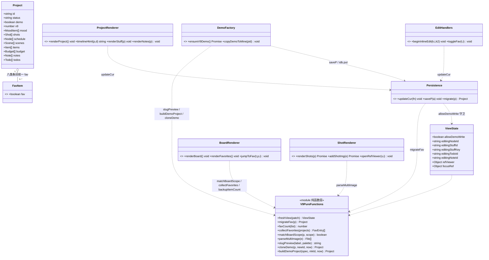
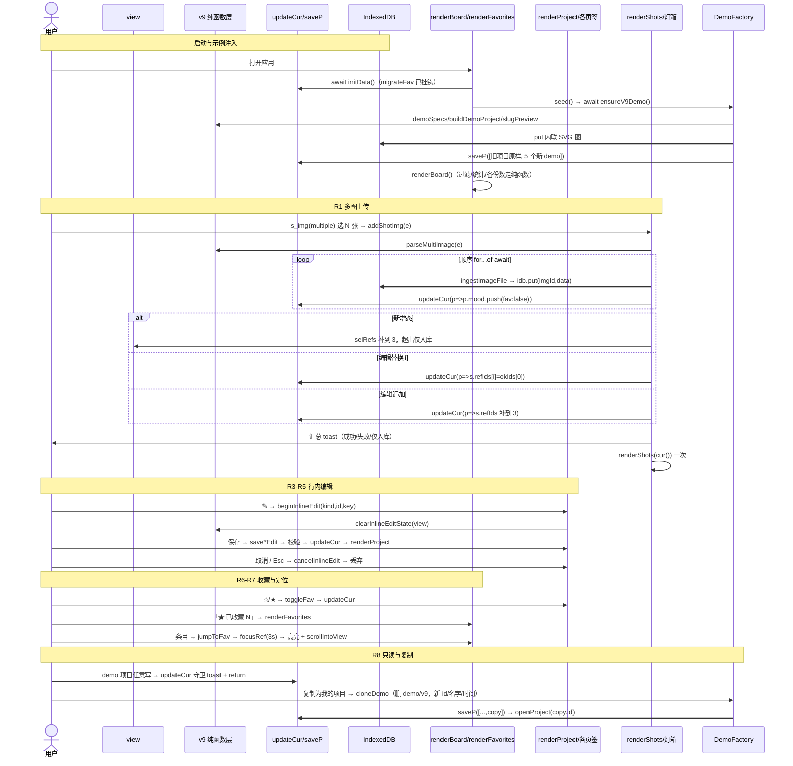
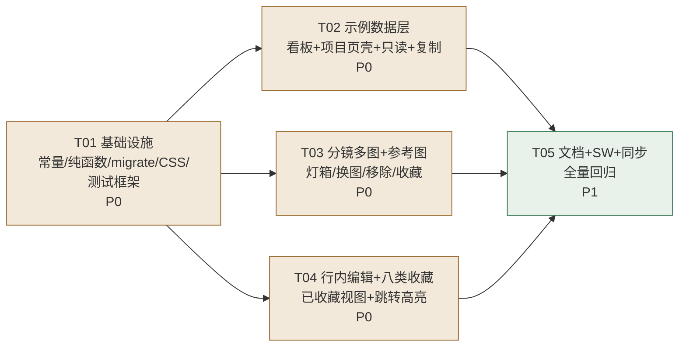

# 瞬刻摄影工作台 Stillmark v9 · 实现设计与任务分解

> 架构师：高见远（Gao）｜基线：`shotflow.html` v8 @ HEAD **`dd12254`**（2098 行单文件全内联）、`tests/logic.test.mjs` **44 项**通过
>
> **本文所有行号均以 `dd12254` 当前源码为准**；代码插入后行号顺延，落地时**以函数名定位**。本文只做设计，不含代码改动。
> 产品经理定稿需求已全部采纳，不再论证；第 5 节只列实现默认决策，无阻塞项。
>
> **实现裁决覆盖（主理人，落码后）**：示例注入按「6 列各一个完整示例」执行——`demoSpecs()` 只返回 5 个新 spec（灵感期 / 策划中 / 后期中 / 已交付 / 已归档），**待拍摄列沿用旧「城市漫游者」**，不再新增「雨后街角 · 都市速写」；全局共 6 个示例。本文下文涉及「6 个新 spec / 7 个示例」的表述均以本裁决为准，README / overview / 测试断言已同步。另：分镜多图上传入口在 demo 项目提前提示一次并 return，`updateCur` 仍是唯一写守卫。

## 0. 需求对齐摘要（已采纳）

| 编号 | 定稿结论 | 落地函数 / 行号（基线） |
|---|---|---|
| D1 | 八类条目统一 `fav:boolean`（默认 false），项目根 `demo:boolean`，`migrate` 幂等补齐 | `migrate` 653–667；新增 `migrateFav` |
| D2 | `STATUSES` 追加「已归档」变 6 项；`STATUS_TAG` 补第 6 色；`.st-5` 配色；看板「进行中/已归档」按新集合 | `STATUSES/STATUS_TAG` 485–486；`renderBoard` 770–833；CSS 97/103 |
| D3 | `ensureV9Demo()` 独立于 `seed()`，用 `localStorage['wb_sf_demo_v9']` 只做一次；5 个新示例 + 现有「城市漫游者」标 demo（全局 6 个示例）；不覆盖用户字段 | `seed` 717–767；启动链 2080–2085 |
| D4 | 示例只读：唯一拦截点在 `updateCur()`；角标、复制为我的项目、隐藏拍摄日、元数据 disabled；「导出此案」保留 | `updateCur` 529；`renderBoard` 819；`renderProject` 856–877 |
| R1 | 分镜多图上传：一次 N 张顺序入库，前 3 张挂当前分镜 / 只补到 3 / 替换只用第 1 张；单张失败跳过并汇总 | `s_img` 1107；`addShotImg` 1213–1234 |
| R2 | 参考图预览/替换/删除：新增态「已选参考图 k/3」条；灯箱「第 i/N 张」+ 更换/移除/关闭 + 上一张/下一张；`shisei:` 占位禁大图 | `renderShots` 1129–1161；`openRefViewer` 1198–1211 |
| R3-R5 | 日程/清单/协作行内编辑，同一时刻只允许一行；`chk → ✎ → ☆ → 🗑`；保存走 `updateCur`，取消/Esc 丢弃 | `timelineHtml` 1383–1405；`renderStuff` 1415–1428；`renderNotes` 1470–1507 |
| R6-R7 | 八类 ☆/★ 即写 `fav`；看板与项目页「★ 已收藏 N」；`view.mode='favorites'` 分组视图；`jumpToFav` 高亮 3 秒 | `renderBoard` 781–789；`renderProject` 863–866；新 `renderFavorites` |
| R8 | 6 示例自动出现、只读、可复制；「已归档」含已交付 | 同 D2/D3/D4 |
| 边界 | 不做跨项目复制收藏、概念页收藏/新编辑、预算编辑、分镜正文编辑、情绪板素材内容编辑、级联顺延、>3 张、新状态、示例在线更新/单条删除、服务端同步、第三方库/构建链 | 全文禁止 |

---

# Part A：系统设计

## 1. 实现方案总述

### 1.1 单文件三层组织（不引入任何运行时文件）

`shotflow.html` 结构：`<style>` 14–321、静态 DOM 324–355、`<script>` 357–2096。v9 在**同一 `<script>`** 内扩层，保持零依赖、零构建、44 项 node 测试可直接跑。

| 层 | 基线位置 | v9 改动 | 硬约束 |
|---|---|---|---|
| **纯函数层** | 数据层 359–363；标签纯函数 531–598；图库纯函数 600–650 | 在 `migrate` 之前（651 行处）追加 v9 纯函数块：`freshView`、`clearInlineEditState`、`migrateFav`、`isFav`、`favCount`、`favSummary`、`summary40`、`collectFavorites`、`backupItemCount`、`matchBoardScope`、`isActiveStatus`、`parseMultiImage`、`slugPreview`、`cloneDemo`、`demoSpecs`、`buildDemoProject` | 全部 `function name(){}` 具名声明；不引用 `document`/`window`/`idb`/`view`/`toast`/`localStorage`；只用可被 `vm` ctx 注入的内置对象（`Array/Object/JSON/String/Number/Date/Set/encodeURIComponent`）。`slugPreview` **不得调用 `esc`**（`esc` 是箭头常量，`fn()` 抽不到），用自带字符白名单替换 |
| **状态层** | `view` 526–527、`cur` 528、`updateCur` 529、`loadP/saveP` 668–677、`initData` 678–694 | `freshView()` 统一构造 view（526、843、1769、1784 四处）；`updateCur` 顶部加 demo 守卫；新增 `ensureV9Demo`/`copyDemoToMine`/`toggleFav`/编辑处理器 | 所有持久化**只走** `updateCur(fn)`（自动 `updatedAt` + 200ms 合并 `saveP`）；demo 初始化例外地直接 `saveP(a)`（一次性追加，不改用户字段）；筛选/编辑/焦点状态永不入库、不导出 |
| **渲染层** | `renderProject` 847–892 总绘制 `#tabBody`，各 `render*` 子函数 | 8 类条目加 `data-fid` + ☆ + 行内编辑；`renderShots` 多图与灯箱增强；新 `renderFavorites`；CSS 全部新增类集中在 T01 | 沿用内联 `onclick` + 全量重绘；动态文本一律 `esc()`，内联事件参数一律 `jstr()`；`renderShots` 末尾仍 `attachDrag()`（1247） |

### 1.2 核心技术难点与对策

1. **44 项测试零回归 + 幂等迁移**
   `logic.test.mjs:17` 的 `vm.createContext` 只注入白名单全局；v9 纯函数用到 `encodeURIComponent`（`slugPreview`），**必须在第 17 行补注入**。`migrate`（653）在既有数组补齐之后、`migrateTags(p)`（665）之前调用 `migrateFav(p)`，只补 `fav` 与 `demo`，不动 `refIds`/`tags`/`tagVocab`；测试(ctx) 里 `migrate({name:'x',shots:[...]})`（`logic.test.mjs:64`）没有 mood 也不会崩。

2. **示例只读必须"一处拦截所有写路径"**
   不逐函数散写 `if(p.demo)`。唯一拦截点是 `updateCur`（529）：
   ```js
   function updateCur(fn){
     const a=loadP(), p=a.find(x=>x.id===view.pid);
     if(!p) return;
     if(p.demo&&!view.allowDemoWrite){ toast('示例项目为只读，可点「复制为我的项目」后再修改'); return; }
     fn(p); p.updatedAt=Date.now(); saveP(a);
   }
   ```
   `view.allowDemoWrite` 默认 `false`，**仅** `copyDemoToMine` 在 `saveP` 期间短暂置 `true`；看板/项目页/元数据/概念页对 demo 的特殊处理只涉及**渲染**（角标、按钮显隐、disabled），不是额外写守卫。

3. **异步多图上传的顺序、部分失败与 3 张上限**
   复用 `ingestImageFile(f,tags)`（1054–1078，800px/JPEG `.72`/IDB 完全不改）；在 `addShotImg` 里用 `for...of await` **顺序**处理，成功 id 进 `okIds`、失败 `failN++` 后继续；全部完成后**一次** `renderShots`。上限按当前真实状态动态计算：新增态 `3-selRefs.length`，编辑追加态 `3-s.refIds.length`，替换态固定 `replaceIdx` 一个位置。超出部分只入库到情绪板并汇总 toast。

4. **全量重绘下的"行内编辑只开一行"与 Esc 优先级**
   `view` 新增五个编辑指针，`beginInlineEdit` 先调纯函数 `clearInlineEditState(view)` 再置其中一个；保存/取消都 `updateCur`→`renderProject()`，未保存输入天然丢弃。`document keydown`（2075–2077）改为显式优先级：`refViewer → confirmModal → 行内编辑 → closeDoc+closeShootDay`。

5. **示例图离线可看且不改渲染链路**
   `slugPreview(label,palette)` 生成内联 SVG dataURL（约 1KB，零网络）；`ensureV9Demo` 用 `uid()` 作 key，`imgCache[key]=dataURL` 并 `await idb.put(key,dataURL)`。所有既有渲染口（`renderMoodGrid` 974、`renderShots` 1111、`openDoc` 1636、`imagesFor` 1723、`cacheProjectImages` 520）**只读 `imgCache[m.content]`**，因此 demo 图与用户上传图走完全相同的路径，无需改渲染函数。

6. **收藏跳转的焦点生命周期**
   `focusRef={type,id,until:now+3000}` 存 view；`jumpToFav` 后异步等 `renderProject()` 完成，再用 `[...document.querySelectorAll('[data-fid]')].find(el=>el.dataset.fid===id)` 定位（**不拼接选择器**，兼容导入的脏 id）；3 秒后重新查询 DOM 按 id 复核清除，避免重绘后清错元素。

7. **状态过滤单一真源**
   `matchBoardScope(p,scope)` 一处定义「已归档 = {已交付,已归档}、进行中 = 其余 4 态」；`renderBoard` 的列过滤（773–780）、进行中指标（791）、今日拍摄（792）、卡片倒计时（815）与 `renderProject` 倒计时（851）全部调用它，杜绝 5 处 `status!=='已交付'` 各自漂移。

### 1.3 架构模式

沿用现有**事件驱动 + 全量重绘（MVC-lite）**：`view` = Controller 会话状态，`loadP/saveP/updateCur` = Model 入口，`renderProject/renderBoard` = View 入口。不引入事件总线、不引入虚拟 DOM、不新增 `<script>` 外链。

---

## 2. 文件清单

### 2.1 `shotflow.html`（唯一运行时改动文件，2098 行 → 约 2600 行）

> 「定位」列为 **HEAD `dd12254` 基线行号**；「改动」列标注新增函数时，插入点写在原函数之前/之后。

| 序 | 定位（函数 / 行号） | 改动 | v9 具体内容 |
|---|---|---|---|
| A | CSS `.dot.st-*`/`.pcard.st-*`（97、103） | 追加 | `.dot.st-5`、`.pcard.st-5::before`（灰墨色 `#9c9389`）；`.tag.ink`（`.tag` 45–47 之后） |
| B | CSS `.iconbtn`（48–49）之后 | 追加 | `.rowbtn`（hover/焦点显现、★ 常亮）、`.inline-edit`（左侧 2px 强调条 + 淡底）、`.selrefs`、`.badge.demo`、`.fav-focus`、`.metacard :disabled`、移动端 `@media (max-width:700px)`（296–313）追加 `.rowbtn{opacity:1;font-size:14px}` |
| C | 数据层 `LS_PROJ/LS_SEED`（359） | 修改 | 追加 `const LS_DEMO_V9='wb_sf_demo_v9';`；`FAV_KINDS/FAV_META/FAV_ICON/FAV_TAB` 常量同处 |
| D | `esc/jstr`（362–363） | 不改 | 所有新 `innerHTML` 继续走这两个出口 |
| E | `STATUSES`/`STATUS_TAG`（485–486） | 修改 | `STATUSES` 末尾追加 `'已归档'`；`STATUS_TAG` 追加 `'ink'`（第 6 色） |
| F | `view`（526–527） | 修改 | `let view=freshView();`；`freshView(patch)` 覆盖全部字段（见 3.2） |
| G | `cur/updateCur`（528–529） | 修改 | `updateCur` 加 demo 守卫（1.2 节代码），**唯一写拦截点** |
| H | `migrate` 之前（651 行处） | 新增 | 16 个 v9 具名纯函数（见 3.2），位于标签纯函数（531–598）与图库纯函数（600–650）之间或紧随其后、`migrate` 之前 |
| I | `migrate`（653–667） | 修改 | 第 664 行后、第 665 行 `migrateTags(p)` 前插入 `migrateFav(p);`；一行改动 |
| J | `loadP/saveP/initData`（668–694） | 不改 | `initData` 已对所有数组跑 `migrate`（685/688），故 `fav/demo` 自动覆盖老数据 |
| K | `cacheProjectImages`（519–523） | 不改 | 按 `m.type==='image'` 读 `idb.get(m.content)`；demo SVG key 自动预载 |
| L | `seed`（717–767） | 修改 | 对象内加 `demo:true`（721 行对象字面量）；首条 mood（725）加 `fav:true`；**不加 `v9` 标记**；`saveP([demo])`（765）、`LS_SEED`（766）不变 |
| M | `ensureV9Demo`（新增，紧随 `seed` 767 后） | 新增 | async；`localStorage[LS_DEMO_V9]` + 项目 `v9:1` 双 guards；追加 6 demo、给旧「城市漫游者」补 `demo:true` 与 1 张 SVG 图；`idb.put` 图片；绝不改用户字段 |
| N | `renderBoard`（770–833） | 修改 | 过滤 774–775 → `matchBoardScope`；mast-actions 783 前插「★ 已收藏 N」；统计 791/792、倒计时 815 → `isActiveStatus/matchBoardScope`；卡片 819 加 demo 角标与 `openProject`；备份数 830 → `backupItemCount(all)`；保留 804 三档按钮 |
| O | `openProject`（843） | 修改 | `view=freshView({mode:'project',pid,tab:'shots'});`，避免新字段在 4 处 view 重置中漂移 |
| P | `TABS`（846）/ `renderProject` 页签（878–883） | 不改 | 7 页签结构与分组视觉不变；`renderFavorites` 是 `mode` 独立视图，不进 TABS |
| Q | `renderProject`（847–892） | 修改 | 851 倒计时 → `matchBoardScope`；858 标题旁 demo 角标；863–866 pactions：demo 隐藏「进入拍摄日模式」、加「复制为我的项目」，两种项目都加「★ 已收藏 N」；867–877 元数据卡 demo 时 input/select/城市 chip `disabled`；891 分发不变 |
| R | `renderConcept`（899–910） | 修改 | demo 时 6 个输入 `disabled`（避免每次 input 都触发只读 toast）；用户项目行为不变 |
| S | `renderMood`/`renderMoodGrid`（913–986） | 修改 | 974/980  mood 项加 `data-fid`、mfoot 加 ☆/★（`toggleFav('mood',id)`）；既有标签 ✎ 保留（标签编辑保持）；913–939 骨架与筛选不动 |
| T | `addMood`/`ingestImageFile`/`addMoodImg`/`delMood`（1044–1086） | 修改 | 新增条目写 `fav:false`；压缩/IDB/标签逻辑一行不改；`addMoodImg` 仍单张（R1 只针对分镜页） |
| U | `renderShots`（1091–1165） | 修改 | 1107 `s_img` 加 `multiple`；1139 后插「已选参考图（k/3）」条（`selRefs` 缩略图+序号+×）；1147–1160 分镜行加 ☆/★ + `data-fid`，按钮序 `drag→chk→refs→文案→☆→🗑` |
| V | `toggleRef`/`openShotRefEditor`/`removeShotRef`（1169–1196） | 修改 | 编辑替换分支仅改 `refIds[i]`（1174）与追加分支补到 3（1175）保持；`view.editingShotId` 状态不变；`removeShotRef` 只改目标分镜 |
| W | `openRefViewer`/`closeRefViewer`（1198–1212） | 修改 | 设置 `view.refViewer={shotId,ri}`；标题「第 i/N 张」已有（1203）保留；加 `refNav(±1)`；`shisei:` 无缓存仍只显示占位（1201/1205），不渲染 `` |
| X | `addShotImg`（1213–1234） | 重写 | `parseMultiImage(e)` → `for...of await ingestImageFile` → 按新增/追加/替换三种模式挂图 → 汇总 toast → `renderShots` 一次 |
| Y | `addShot`（1235–1244） | 修改 | 新分镜对象加 `fav:false`；`selRefs=[]`、draft 清空、ord 计算均不变 |
| Z | `renderSchedule`（1306–1336） | 不改 | `schedDate`（1304）保持；编辑保存后不重置 |
| AA | `timelineHtml`/`addNode`/`toggleNode`/`delNode`（1383–1412） | 修改 | 节点行 `chk→✎→☆→🗑`；编辑态内联输入 `en_*`；新增 `saveNodeEdit`；`addNode` 写 `fav:false`；分镜行在日程里保持只读（☆ 只在分镜页给） |
| AB | `renderStuff`/`addStuff`/`toggleStuff`/`delStuff`（1415–1438） | 修改 | 三区块行 `chk→✎→☆→🗑`；`view.editingStuffId+Key` 定位；`es_name/es_note` 内联；`saveStuffEdit`；新条目 `fav:false` |
| AC | `renderBudget`/`addBudget`（1442–1465） | 修改 | **只加 ☆/★ + `data-fid`**，不加 ✎；新条目 `fav:false`；金额/支付逻辑不改 |
| AD | `renderNotes`/`addTodo`/`delTodo`/`addNote`/`delNote`（1470–1520） | 修改 | 待办 `chk→✎→☆→🗑`，沟通 `✎→☆→🗑`；`et_*`/`en_*` 内联输入；`saveTodoEdit`/`saveNoteEdit`（保留原 `ts`）；新条目 `fav:false` |
| AE | `askConfirm`（1774） | 不改 | 删除仍二次确认；Esc 优先级中 `confirmModal` 排第二 |
| AF | `applyImport`/`clearAll`（1757–1786） | 修改 | view 重置改 `freshView()`；导入的 demo 字段由 `migrateFav` 规范化（不剥夺 demo 只读属性） |
| AG | `exportJSON`/`exportProject`/`collectImages`（1715–1737） | 不改 | `fav/demo/v9` 随项目 JSON 自然流转；demo 图 key 与用户图一并由 `imagesFor` 导出 |
| AH | `openDoc`/`writeProposalFile`（1614–1707） | 不改 | 对外文档不显示 fav/demo；`manual` 文字标签（1637）保持 v6 行为 |
| AI | `renderFavorites`/`openFavorites`/`jumpToFav`（新增，建议置于 `renderBoard` 之后 833 行处） | 新增 | `view.mode='favorites'` 独立视图；项目→模块分组；行「类型图标+40 字摘要+模块+定位›」；跳转设 `schedDate`/`focusRef` |
| AJ | `document keydown`（2075–2077） | 修改 | Esc 四级优先级；调用 `cancelInlineEdit()` |
| AK | 启动链（2080–2085） | 修改 | `await initData(); seed(); await ensureV9Demo(); renderBoard();`，其余 PWA/图库启动不变 |
| AL | PWA 注册（2057–2074） | 不改 | 注册逻辑不变；**发布时 SW 版本必须 bump（见 2.5）** |

### 2.2 `tests/logic.test.mjs`（154 行 → 约 215 行）

| 序 | 定位 | 改动 |
|---|---|---|
| 1 | 第 17 行 | `vm.createContext({..., RegExp, Set, encodeURIComponent})` —— 补 `encodeURIComponent`（`slugPreview` 需要）。这是唯一框架级注入变化 |
| 2 | 第 18 行抽取列表 | 追加：`freshView,clearInlineEditState,migrateFav,isFav,favCount,favSummary,summary40,collectFavorites,backupItemCount,matchBoardScope,isActiveStatus,parseMultiImage,slugPreview,cloneDemo,demoSpecs,buildDemoProject` |
| 3 | 第 64–95 行之后 | 追加 **15 项** v9 断言（明细见 7.T01 验收点）；原有 44 项断言**一行不删不改** |
| 4 | 第 153 行 | `RESULT` 计数 44 → 59；`process.exit(fail?1:0)` 不变 |

### 2.3 `README.md`（148 行）

- 28–30 行：看板段补「★ 已收藏」入口与「已归档含已交付」。
- 32–42 行页签表：情绪板补「☆ 收藏」；分镜补「多图上传 / 参考图灯箱上一张下一张 / ☆」；日程、清单、协作补「行内编辑 + ☆」；预算补「只加 ☆」。
- 66 行：备份提醒注明「不计入示例项目」。
- 74–76 行：主程序描述 v8 → v9；SW 版本描述 v4 → v9。
- 115 行：交付后改状态一句补「已归档筛选同时含已交付与已归档」。
- 124–125 行「预置示例」：改为 6 个示例（5 个新 + 城市漫游者），只读、可复制、7 页签完整、离线内联 SVG 图、示例不进备份提醒。
- 127–135 行：新增 **v9** 迭代记录（置于 v8 之上）。
- 137–145 行：已知限制补「示例只读，需复制后才能改；收藏不跨项目；示例图离线内嵌不联网」。

### 2.4 `overview.md`（53 行）

- 第 4 行：v8 → v9，44 → 59 项测试。
- 9–21 行数据模型：8 类条目加 `fav:boolean`，项目加 `demo:boolean`（+ 可选 `v9:1` 标记）。
- 27–42 行关键实现：新增「示例一次性注入 / 单守卫只读 / 复制为我的项目」「多图上传与参考图灯箱」「行内编辑与收藏跳转高亮 3 秒」三条。
- 第 40 行测试描述：44 → 59；第 41 行 PWA：SW v8 → v9。

### 2.5 部署相关文件（非逻辑改动，但发布必做）

- `shotflow-sw.js:1`：`const CACHE='shotflow-v8'` → `'shotflow-v9'`（**硬性要求**：SW 不 bump 会导致 PWA 用户拿不到 v9；`ASSETS` 2–7 行不变）。
- `shotflow-app/shotflow.html`：从 `shotflow.html` 整体 `cp` 同步，部署 `shotflow-app/`；`diff` 必须为空。
- **不新增**任何 `.js`/`.css`/图片文件；示例图以 dataURL 写在主脚本内，PWA 缓存清单不变。

---

## 3. 数据结构与接口

### 3.1 精确数据结构（TypeScript-like）

```ts
type FavKind = 'mood'|'shots'|'schedule'|'scenes'|'items'|'budget'|'notes'|'todos';

interface FavItem { fav: boolean; }              // 8 类条目统一，默认 false；migrateFav 幂等补齐

interface MoodItem extends FavItem {
  id: string; type: 'text'|'color'|'image'; content: string;
  tag: string; tags: string[]; autoTags?: string[];   // v6 字段完全不变
}
interface Shot extends FavItem {
  id: string; name: string; date: string; slot: string; duration: number;
  sceneId: string; refIds: string[]; note: string; done: boolean; ord: number; // refIds ≤3 不变
}
interface Node extends FavItem {
  id: string; type: string; title: string; start: string; end: string;
  note: string; date?: string; done: boolean;          // 行内编辑不改 date/done/fav
}
interface Scene  extends FavItem { id: string; name: string; note: string; done: boolean; }
interface Item   extends FavItem { id: string; kind: string; name: string; note: string; done: boolean; }
interface Budget extends FavItem { id: string; item: string; cat: string; amount: number; paid: boolean; }
interface Note   extends FavItem { id: string; kind: string; content: string; ts: number; } // 编辑保留 ts
interface Todo   extends FavItem { id: string; title: string; owner: string; due: string; done: boolean; }

interface Project {
  id: string; name: string; client: string; studio: string; status: '灵感期'|'策划中'|'待拍摄'|'后期中'|'已交付'|'已归档';
  shootDate: string; location: string; lat: string|number; lng: string|number;
  v3: number; createdAt: number; updatedAt: number;
  concept: { theme: string; model: string; style: string; audience: string; usage: string; note: string };
  mood: MoodItem[]; shots: Shot[]; schedule: Node[]; scenes: Scene[]; items: Item[];
  budget: Budget[]; notes: Note[]; todos: Todo[]; tagVocab: string[];
  demo: boolean;      // 新增：只读示例标记，默认 false
  v9?: number;        // 新增：ensureV9Demo 注入的幂等标记（值 1）；cloneDemo 删除；不参与 UI
}

interface ViewState {   // 会话内，不持久化、不导出；由 freshView() 统一构造
  mode: 'board'|'project'|'favorites'; pid: string|null; tab: string;
  shotFilter: string; boardQuery: string; boardScope: '全部'|'进行中'|'已归档';
  moodFilter: string[]; moodFilterMode: 'any'|'all';
  shotDraft: Object; poseCat: string|null; editingShotId: string|null; replaceIdx: number;
  allowDemoWrite: boolean;                       // 默认 false，唯一逃生阀
  editingNodeId: string|null; editingStuffId: string|null; editingStuffKey: string|null;
  editingTodoId: string|null; editingNoteId: string|null;   // 五者同一时刻只允许一个非空
  refViewer: {shotId: string; ri: number}|null;
  focusRef: {type: FavKind; id: string; until: number}|null;
}

interface FavEntry {
  type: FavKind; pid: string; id: string; summary: string; // 摘要≤40 字（超长加 …）
  module: string;                                          // 情绪板/分镜/日程/清单/预算/协作
  date: string;                                            // 仅 schedule 有值，供跳转设 schedDate
}

interface DemoSpec {
  status: string; name: string; theme: string; label: string;
  art: [string,string][];                                  // 每张 mood 图的调色板 [主色,底色]
  moodTexts: string[]; shotNames: string[]; nodeTitles: string[];
  sceneNames: string[]; itemNames: string[]; budgetItems: string[];
  noteTexts: string[]; todoTitles: string[];
  fullRefShot: boolean;                                    // true 时第 1 条分镜挂满 3 张 refIds
  favType: FavKind; favIndex: number;                      // 至少一个 fav:true 的落点
}
```

### 3.2 新增纯函数签名与语义（全部具名 `function`，可被 `fn()` 抽取）

| 函数 | 签名 | 语义 / 边界 |
|---|---|---|
| `freshView` | `function freshView(patch): ViewState` | 返回**完整**默认 view 对象（3.1 全部字段），`Object.assign(defaults, patch||{})`。526、843、1769、1784 四处统一调用，杜绝字段漂移；不改入参 |
| `clearInlineEditState` | `function clearInlineEditState(v): ViewState` | 就地清空传入 `v` 的 5 个编辑指针（Node/Stuff/StuffKey/Todo/Note），返回 `v`；不引用全局 `view`；不改 `editingShotId/replaceIdx` |
| `migrateFav` | `function migrateFav(p): Project` | 幂等：`FAV_KINDS` 八数组缺失/非数组→`[]`；每项 `it.fav = (it.fav===true)`（字符串 `"true"` 归 false）；`p.demo=(p.demo===true)`；**不动** `refIds/tags/tagVocab/ts/done`，不删 `v9` |
| `isFav` | `function isFav(it): boolean` | `!!(it && it.fav===true)`，唯一收藏判定口 |
| `favCount` | `function favCount(list): number` | 非数组→0；统计 `isFav` 为真的项数 |
| `favSummary` | `function favSummary(type,it): string` | 按类型取摘要源：mood→text/content（image 固定 `'图片'`）、shots→name、schedule→title、scenes/items→name、budget→item、notes→content、todos→title；空值返回 `''` |
| `summary40` | `function summary40(s): string` | `String(s??'').replace(/\s+/g,' ').trim()`，超过 40 字符截前 40 并加 `…`；用于已收藏视图行摘要 |
| `collectFavorites` | `function collectFavorites(projects): FavEntry[]` | 遍历项目×八类，仅收 `isFav(it)`；产出扁平 `FavEntry[]`（`pid/id/type/module/summary/date`）；**不按项目复制条目**，不排序（保留项目→集合原序），不改入参 |
| `backupItemCount` | `function backupItemCount(projects): number` | 只统计 `!p.demo` 项目的 `shots+mood+items+budget+todos+notes` 条数；`renderBoard:830` 用；demo 不触发备份提醒 |
| `matchBoardScope` | `function matchBoardScope(p,scope): boolean` | `'已归档'` → `p.status==='已交付'||p.status==='已归档'`；`'进行中'` → **非**上述两者；其余 → true；空项目对象安全 |
| `isActiveStatus` | `function isActiveStatus(p): boolean` | `matchBoardScope(p,'进行中')` 的语义别名，供统计/倒计时调用 |
| `parseMultiImage` | `function parseMultiImage(e): File[]` | `Array.from((e&&e.target&&e.target.files)||[])`，过滤 `!f.type \|\| /^image\//.test(f.type)`；不读 `document`、不修改 `input.files`；测试可传伪事件 |
| `slugPreview` | `function slugPreview(label,palette): string` | 生成内联 SVG dataURL：`'data:image/svg+xml;charset=utf-8,'+encodeURIComponent(svg)`；`label` 用 `[<>&"']` 白名单剔除（**不调用 `esc`**）；`palette` 取 `[主色,底色]`，缺省 `['#9a6a33','#f3e9da']`；输出零 `http` 引用 |
| `cloneDemo` | `function cloneDemo(p,newId,now): Project` | 纯深拷贝：`JSON.parse(JSON.stringify(p||{}))`；`delete c.demo; delete c.v9; c.v3=1; c.id=newId; c.name=(c.name\|\|'示例')+'（副本）'; c.createdAt=c.updatedAt=now`；原对象不变；图片 content 键共享（IDB 同名 key 复用） |
| `demoSpecs` | `function demoSpecs(): DemoSpec[]` | 返回 5 个固定 spec（状态：灵感期/策划中/后期中/已交付/已归档；待拍摄列沿用旧「城市漫游者」），每 spec 满足 3.4 完整性表；无随机、无 Date |
| `buildDemoProject` | `function buildDemoProject(spec,mkId,now): Project` | 用注入的 `mkId(tag)` 生成全部 id（生产传 `()=>uid()`，测试传确定性函数）；组装 7 页签非空数据，末尾跑 `migrateFav`+`migrateTags`（经 `migrate`），按 `favType/favIndex` 置一个 `fav:true`；`fullRefShot` 时 `shots[0].refIds = moodImgs.slice(0,3).map(m=>m.content)`；写 `demo:true,v9:1,v3:1` |

**状态层函数（非纯，允许 DOM/IDB）**

| 函数 | 签名 | 语义 |
|---|---|---|
| `ensureV9Demo` | `async function ensureV9Demo(): Promise<void>` | 见 3.5 |
| `copyDemoToMine` | `function copyDemoToMine(pid): void` | 找 demo → `cloneDemo(p,uid(),Date.now())` → `view.allowDemoWrite=true` → `saveP([...loadP(),copy])` → `false` → `openProject(copy.id)` → toast |
| `copyToMineButton` | `function copyToMineButton(pid): string` | 纯字符串渲染 helper（可选）：返回 demo pactions 的按钮 HTML，供 `renderProject` 复用 |
| `beginInlineEdit` | `function beginInlineEdit(kind,id,key): void` | `clearInlineEditState(view)` → 按 `kind∈{Node,Stuff,Todo,Note}` 置唯一指针 → `renderProject()` |
| `cancelInlineEdit` | `function cancelInlineEdit(): boolean` | 有编辑位则清空并 `renderProject()` 返回 true；否则 false（供 Esc 链判断） |
| `toggleFav` | `function toggleFav(type,id): void` | `updateCur(p=>{const it=(p[type]\|\|[]).find(x=>x.id===id); if(it) it.fav=!isFav(it);})`；随后按当前页 `renderProject()` 或 `renderShots(cur())`；demo 项目由 `updateCur` 自动拦截 |
| `openFavorites/renderFavorites` | `function openFavorites(): void` / `function renderFavorites(): void` | `view=freshView({mode:'favorites'})`；`#app` 渲染分组视图 |
| `jumpToFav` | `function jumpToFav(type,pid,id): void` | 见 4.2 ⑤ |
| `refNav` | `function refNav(delta): void` | 从 `view.refViewer` 取 `shotId/ri`，`openRefViewer(shotId,(ri+delta+N)%N)`；无 viewer 时 no-op |

### 3.3 `updateCur` 守卫与 `allowDemoWrite` 的精确写法

```js
/* 基线 526–529 改为 */
function freshView(patch){
  const d={mode:'board',pid:null,tab:'shots',shotFilter:'',boardQuery:'',boardScope:'全部',
    moodFilter:[],moodFilterMode:'any',shotDraft:{},poseCat:null,editingShotId:null,replaceIdx:-1,
    allowDemoWrite:false,editingNodeId:null,editingStuffId:null,editingStuffKey:null,
    editingTodoId:null,editingNoteId:null,refViewer:null,focusRef:null};
  return Object.assign(d,patch||{});
}
let view=freshView();
const cur=()=>loadP().find(p=>p.id===view.pid);
function updateCur(fn){
  const a=loadP(), p=a.find(x=>x.id===view.pid);
  if(!p) return;
  // 唯一 demo 写拦截点：覆盖勾选/收藏/编辑/标签/元数据/概念/删除等全部写路径
  if(p.demo&&!view.allowDemoWrite){ toast('示例项目为只读，可点「复制为我的项目」后再修改'); return; }
  fn(p); p.updatedAt=Date.now(); saveP(a);
}
```

- `allowDemoWrite` 默认 `false`；**只有** `copyDemoToMine` 用 `try/finally` 短暂置 `true`（且它并不调用 `updateCur`，只 `saveP`；保留该字段作为唯一受控逃生阀）。
- `openProject`（843）、`applyImport`（1769）、`clearAll`（1784）必须改用 `freshView(...)`，否则新字段丢失会让守卫/编辑态失效。

### 3.4 示例完整性与注入策略（`ensureV9Demo`）

**5 个新示例 spec（待拍摄列沿用旧「城市漫游者」）**

| # | status | name（示意） | mood（≥3，含图） | shots≥2 | schedule≥2 | scenes+items≥3 | budget≥2 | notes≥2 | todos≥2 | 特殊 |
|---|---|---|---|---|---|---|---|---|---|---|
| 1 | 灵感期 | 微光肖像 · 暗调练习 | 3（2 文 + 1 图） | 2 | 2 | 3 | 2 | 2 | 2 | — |
| 2 | 策划中 | 城市漫游者 · 胶片提案 | 5（2 文 + 3 图） | 3 | 3 | 4 | 3 | 2 | 3 | **第 1 条分镜 refIds 挂满 3 张图** |
| 3 | 待拍摄 | 夏末海边 · 情侣写真 | 4（2 文 + 1 色 + 1 图） | 3 | 3 | 4 | 2 | 3 | 2 | — |
| 4 | 后期中 | 山野旅拍 · 秋色 | 4（2 文 + 2 图） | 2 | 2 | 3 | 2 | 2 | 2 | — |
| 5 | 已交付 | 咖啡馆品牌 · 秋冬上新 | 4（2 文 + 1 色 + 1 图） | 3 | 3 | 4 | 3 | 3 | 3 | status=已交付，验证「已归档」筛选包含它 |
| 6 | 已归档 | 旧城改造 · 建筑记录 | 3（1 文 + 2 图） | 2 | 2 | 3 | 2 | 2 | 2 | status=已归档 |

- 所有 spec 的 `concept` 六字段均非空；每个 spec 由 `favType/favIndex` 指定**至少 1 条 `fav:true`**。
- 待拍摄列的示例是 `seed()` 的「城市漫游者 · 人像写真」：`demo:true` + 首条 mood `fav:true`；若老数据里它没有 image 类型，`ensureV9Demo` **追加**一张 SVG 图 mood（不改任何既有字段）。

**幂等策略（精确到步骤）**

1. `const flag = localStorage.getItem('wb_sf_demo_v9')==='1'`（try/catch 包裹，隐私模式降级为 false）。
2. `const a=loadP()`；若 `flag===true || a.some(p=>p.demo&&p.v9===1)` → **立即 return**（双 guard 防止 `saveP` 200ms 崩溃导致重复注入）。
3. 找到 `!p.demo && p.name.indexOf('城市漫游者')===0` 的旧项目：只写 `p.demo=true`，缺图时追加一张 SVG mood，缺 fav 时给首条 mood 写 `fav:true`；**其余字段一个不动**。
4. `demoSpecs().forEach(spec=>a.push(buildDemoProject(spec,()=>uid(),Date.now())))`。
5. `saveP(a)` 后立即 `localStorage.setItem('wb_sf_demo_v9','1')`（先标记再 await 图片写入）。
6. 所有 SVG dataURL：`imgCache[key]=data` 且 `await idb.put(key,data)`（逐张 try/catch，失败仍保留内存图）。
7. 全程不调用 `seed()`；`LS_SEED='wb_sf_seeded'` 语义不变。

### 3.5 类图

见 `docs/class-diagram.mermaid`（同步嵌于第 4 节前，此处仅列关系要点）：



> 注：完整类图（含 8 类条目、FavEntry、DemoSpec、DocOutput 及全部关系）以 `docs/class-diagram.mermaid` 为准；上面是本设计文档的精简视图。

### 3.6 八类条目的渲染契约（统一约定，工程师逐行照抄）

| 类型 | 规范渲染函数 / 基线行号 | 行容器属性 | 按钮顺序 | 编辑范围 |
|---|---|---|---|---|
| `mood` | `renderMoodGrid` 972–983 | `data-fid` 加在 `.mood-item` | 既有 `del/✎(标签)` + **新增 ☆/★** | 只保留 v6 标签编辑，不编辑素材内容 |
| `shots` | `renderShots` 1154–1160 | `data-fid` 加在 `.shot` | `drag→chk→refs→文案→☆→🗑` | 不编辑正文；仅参考图操作 |
| `schedule` | `timelineHtml` 1398–1402（仅 `_t==='node'`） | `data-fid` 加在 `.tl-item` | `chk→✎→☆→🗑` | type/title/start/end/note；不改 date/done |
| `scenes` | `renderStuff('scenes')` 1419–1422 | `data-fid` 加在行 `div.row` | `chk→✎→☆→🗑` | name/note；不改 done |
| `items` | `renderStuff('items_s'/'items_g')` 同上 | 同上 | 同上 | name/note；不改 kind/done |
| `budget` | `renderBudget` 1453–1456 | `data-fid` 加在 `.brow` | `paid→☆→🗑` | **不提供 ✎** |
| `notes` | `renderNotes` 1497–1504 | `data-fid` 加在 `.note-item` | `✎→☆→🗑` | kind/content；**保留 ts** |
| `todos` | `renderNotes` 1480–1488 | `data-fid` 加在行 `div.row` | `chk→✎→☆→🗑` | title/owner/due；不改 done |

- ☆/★ 输出统一：`isFav(it)?'★':'☆'`；button `title="收藏/取消收藏"`、`onclick="toggleFav('type',id)"`。
- ✎ 输出统一：`onclick="beginInlineEdit('Node'|'Stuff'|'Todo'|'Note',id,'key')"`（仅 Stuff 传第三参）。
- 删除沿用 `askConfirm` 的既有函数（分镜/清单/日程/预算/协作有；mood 无确认，保持现状）。

---

## 4. 程序调用流程

### 4.1 时序图

完整 Mermaid 见 `docs/sequence-diagram.mermaid`（下列为同一流程的精简主干）：



### 4.2 关键流程编号步骤（可直接对照验收）

**① 启动 / 示例注入（2080–2085、717–767、`ensureV9Demo`）**
1. `await initData()`（678）读 IDB → 逐项 `migrate`（653：`migrateFav` + `migrateTags`）→ 写回。
2. `seed()`（717）：首装写「城市漫游者」，`demo:true` + 首 mood `fav:true`。
3. `await ensureV9Demo()`：按 3.4 双 guard → 补旧项目的 demo/图/fav → `buildDemoProject` ×6 → `saveP` → 写 flag → `idb.put` SVG 图。
4. `renderBoard()`（770）：`matchBoardScope` 过滤、`backupItemCount` 预算提醒、demo 角标。
5. `shiseiInitReady=true; startShiseiSync()`（2084）不变。

**② R1 多图上传 → 挂图（1107、1213–1234）**
1. `s_img` 选 N 张 → `addShotImg(e)` 同步取 `view.editingShotId/replaceIdx`（1215）。
2. `parseMultiImage(e)` 得有序 `files[]`；`e.target.value=''` 立即清 input（可重复选同图）。
3. `for (const f of files){ const id=await ingestImageFile(f,[]); id?okIds.push(id):failN++; }`（单张失败仅 toast 后继续）。
4. 新增态：`need=3-selRefs.length`，`selRefs.push(...okIds.slice(0,need))`，其余只入库。
5. 编辑替换态：`s.refIds[replaceIdx]=okIds[0]`（其余只入库）；编辑追加态：`need=3-s.refIds.length`，逐个 push。
6. 汇总 toast（例：`已存入情绪板 5 张，挂到分镜 3 张，失败 1 张`），`renderShots(cur())` 一次；`selRefs` 条显示 `k/3`。

**③ R2 灯箱 / 换图 / 移除（1198–1212、1169–1196）**
1. 点分镜缩略图 → `openRefViewer(shotId,ri)`，记录 `view.refViewer`，渲染「第 ri+1/N 张」+ ‹/› + 更换/移除/关闭。
2. `shisei:` 且 `imgCache[key]` 为空 → 只渲染占位文字（1205），不渲染 ``；更换/移除照常可用。
3. `refNav(±1)` 环形切换；`openShotRefEditor` 进入选图态并置 `replaceIdx=ri`（1188–1191）。
4. `toggleRef` 的 `replaceIdx>=0` 分支只写 `s.refIds[ri]`（1174）；`removeShotRef` 只 `splice` 该分镜（1193–1196）；情绪板原图与其它分镜不受影响。

**④ R3-R5 编辑保存（1383–1412、1415–1438、1470–1520）**
1. ✎ → `beginInlineEdit(...,id,key)` 先清空五个指针 → 只设一个 → `renderProject()`。
2. 输入保存在 DOM 中，未点保存前不写库；Esc 由 `cancelInlineEdit()` 丢弃。
3. 保存校验：日程 title 非空且 `toMin(end)>toMin(start)`（1339）；清单/待办 title 非空；沟通 content 非空。
4. `updateCur(p=>Object.assign(target,白名单字段))` → done/date/fav/ts/kind(物品)/owner 等不在白名单的字段保持原值。
5. `clearInlineEditState(view)` → `renderProject()`；日程 `schedDate`（1304）未动，重叠由 `dayItems`（1341）重算，**不调用 `cascadeShift`**。

**⑤ R6-R7 收藏与跳转（渲染契约 3.6、`renderFavorites`/`jumpToFav`）**
1. ☆/★ → `toggleFav(type,id)` → `updateCur` 写 `fav` → 当前页重绘；demo 项目被 529 守卫拦截并 toast。
2. 看板/项目页按钮调用 `collectFavorites(loadP()).length` 显示「★ 已收藏 N」。
3. `openFavorites()` → `view=freshView({mode:'favorites'})` → `renderFavorites()` 按项目→模块分组，行显示 `FAV_ICON[type] + summary40 + module + '定位›'`。
4. `jumpToFav(type,pid,id)`：`freshView({mode:'project',pid,tab:FAV_TAB[type]})`；日程先把 `schedDate` 设为 `FavEntry.date||p.shootDate||todayStr()`。
5. `view.focusRef={type,id,until:Date.now()+3000}` → `await cacheProjectImages(p)` → `renderProject()` → 遍历 `[data-fid]` 比对 `dataset.fid` → 加 `.fav-focus` + `scrollIntoView({block:'center'})`。
6. `setTimeout(3000)` 重新查询 DOM、按 id 复核清 class 与 `focusRef`；期间用户切页也不会清错元素。

**⑥ R8 demo 只读 / 复制（529、863–866、969–986、`copyDemoToMine`）**
1. demo 项目：看板卡片与项目标题显示「示例」角标；pactions 只有「导出此案」「复制为我的项目」「★ 已收藏 N」，隐藏拍摄日模式；元数据/概念输入 disabled。
2. 任意漏网写路径（如 ☆、勾选、标签 ✎）到 `updateCur` 统一 toast + return。
3. 点「复制为我的项目」→ `copyDemoToMine(pid)` → `cloneDemo(p,uid(),Date.now())`（删 demo/v9、新 id、名字加「（副本）」、刷新时间、图片 key 共享）。
4. `allowDemoWrite=true` → `saveP([...a,copy])` → `false` → `openProject(copy.id)` → toast；副本所有编辑能力恢复。

**⑦ Esc 优先级（2075–2077）**
1. `refViewer.show` → `closeRefViewer()` 并 return。
2. 否则 `confirmModal.show` → `closeConfirm()` 并 return。
3. 否则 `cancelInlineEdit()` 返回 true → 已丢弃编辑，return。
4. 否则 `closeDoc(); closeShootDay();`。

**⑧ 看板筛选（770–833）**
1. `ps=all.filter(p=>matchBoardScope(p,view.boardScope) && 搜索命中)`。
2. `active/todayShoots/卡片倒计时` 全部用 `isActiveStatus/matchBoardScope`。
3. `backupItemCount(all)` 排除 demo 后决定 `#backupTip.show`（831）。

---

## 5. Anything UNCLEAR（默认决策，无需阻塞评审）

| # | 事项 | 默认决策 | 备注 |
|---|---|---|---|
| 1 | 「已收藏 N」是否统计 demo 项目里历史遗留的 `fav:true` | **统计**（数据如实呈现），条目在已收藏视图显示「示例」角标，跳转后仍只读 | 用户无法在 demo 中新增收藏；若主理人希望完全隐藏，只需在 `collectFavorites` 加 `if(p.demo) return;` |
| 2 | 第 6 色具体色值与类名 | `STATUS_TAG[5]='ink'`，CSS 追加 `.tag.ink`（灰墨底）；`.dot.st-5/.pcard.st-5::before=#9c9389` | 副作用：`NODE_COLORS`（1303）的 `'其他'` 也用 `ink`，会由默认主色变为灰墨，属视觉修正 |
| 3 | demo 概念页输入如何处理 | 与元数据卡一致加 `disabled`（避免逐字输入触发只读 toast） | 用户项目概念页自动保存行为不变 |
| 4 | demo 图存储方式 | `uid()` 作 key + 内联 SVG dataURL 写 `images` store + `imgCache` 预热 | 不改 `cacheProjectImages`/渲染函数；导出备份会包含这些极小图片 |
| 5 | 示例幂等标记 | `localStorage['wb_sf_demo_v9']` 为主，项目上 `v9:1` 为辅（崩溃恢复）；`cloneDemo` 删除 `v9` | 不新增状态枚举，不影响 UI |
| 6 | 项目页「★ 已收藏 N」点击行为 | 与看板同款：进入全局 `favorites` 视图 | 不做项目内收藏筛选（边界外） |
| 7 | 日程时间轴里的分镜行是否加 ☆ | 不加；分镜的 ☆ 只在分镜页规范行出现 | 避免同一条目两处入口状态不同步 |
| 8 | 发布时 SW 是否必须 bump | **必须**：`shotflow-sw.js:1` `shotflow-v8`→`shotflow-v9` | 否则 PWA 用户因缓存拿不到 v9 |

> 以上 8 项均已在设计中给出可直接执行的默认值；**无需要主理人额外决策的阻塞项**。如主理人否决其中某项，仅影响对应单点，不改任务划分。

---

# Part B：任务分解

## 6. 所需依赖包

**无第三方依赖、无构建步骤。**

- 运行时：仅 `shotflow.html`（原生 DOM / IndexedDB / Canvas / FileReader / `encodeURIComponent` / 内联 SVG dataURL）
- 测试：`node tests/logic.test.mjs`（Node 内置 `node:fs`、`node:vm`；直接运行，无需 npm install）
- 明确不新增：`package.json`、bundler、UI 库、图片文件、外链脚本/样式、任何服务端依赖

## 7. 任务列表（按依赖排序，共 5 条；每条 ≥3 个改动区域）

> 本项目只有一个运行时文件，"源文件"列按**函数/行号区域**标注（等价于模块化项目中的文件分组）。T01 承担"项目基础设施"角色：常量 + 测试框架 + 纯函数层 + 迁移挂钩 + 全局 CSS，全部收敛在一个任务。

### T01 · 基础设施：v9 常量 / 纯函数层 / 迁移挂钩 / 测试框架 / 全局 CSS（P0，依赖：无）

**改动区域**
1. `shotflow.html` 359、485–486：`LS_DEMO_V9`、`FAV_KINDS/FAV_META/FAV_ICON/FAV_TAB`、`STATUSES`/`STATUS_TAG` 第 6 项
2. `shotflow.html` 526–529：`freshView()` + `view=freshView()` + `updateCur` demo 守卫
3. `shotflow.html` 651 行处：16 个 v9 具名纯函数（3.2）
4. `shotflow.html` 653–667：`migrate` 插入 `migrateFav(p)`
5. `shotflow.html` CSS 45–49/97/103/296–313：`.tag.ink`、`.st-5`、`.rowbtn`、`.inline-edit`、`.selrefs`、`.badge.demo`、`.fav-focus`、`:disabled`、移动端常显
6. `tests/logic.test.mjs` 17–18、64–95 后、153：ctx 注入 `encodeURIComponent`；追加 16 个抽取名；新增 15 项断言；RESULT 44→59

**验收点**
- `node tests/logic.test.mjs` 原有 **44 项全 PASS**（尤其 `migrate refId→refIds`、`migrate 补 duration`、`initData 迁移旧数据` 三项）
- 15 项新增全过（逐项）：① `freshView` 默认值/patch；② `clearInlineEditState` 五指针清空；③ `migrateFav` 八数组 + demo 默认 false；④ `migrateFav` 保留 true 且二次 JSON 相等；⑤ `isFav`+`favCount` 混合数组；⑥ `summary40` 40 字截断与空白折叠；⑦ `favSummary` 8 类映射；⑧ `collectFavorites` 字段与排除非 fav；⑨ `backupItemCount` 排除 demo；⑩ `matchBoardScope` 三档；⑪ `isActiveStatus` 六状态；⑫ `parseMultiImage` 伪事件过滤；⑬ `slugPreview` dataURL 前缀且零 `http`；⑭ `cloneDemo` 深拷贝/删 demo+v9/新 id/名字/时间且原对象不变；⑮ `demoSpecs().length===5` 且 `buildDemoProject` 对 5 spec 均满足 7 页签非空 + mood≥3 含图 + 1 个 3 图 refIds + ≥1 fav
- 全部新增纯函数可由 `fn(name)` 抽取（具名 `function`），且无 `document/window/idb/view/toast`
- 44+15=59，`RESULT pass=59 fail=0`，退出码 0

### T02 · 示例数据层 + 看板/项目页壳改造（P0，依赖：T01）

**改动区域**
1. `shotflow.html` 717–767 `seed()`：`demo:true`、首 mood `fav:true`（不写 `v9`）
2. `shotflow.html` 767 后新增 `ensureV9Demo`/`copyDemoToMine`/`slugPreview` 调用与 SVG 常量；2080–2085 启动链接入
3. `shotflow.html` 770–833 `renderBoard()`：三档过滤/统计/倒计时/备份数纯函数化、★入口、demo 角标
4. `shotflow.html` 843 `openProject()` 与 1757–1786 `applyImport/clearAll`：view 重置改 `freshView`
5. `shotflow.html` 856–877 `renderProject()`、899–910 `renderConcept()`：pactions、元数据与概念 disabled、demo 角标
6. `shotflow.html` 1044–1086 新条目写 `fav:false`（mood 部分）

**验收点**
- 老数据首次打开只注入一次：刷新页面后项目数不再增加；`localStorage.wb_sf_demo_v9==='1'`；手动删 flag 但保留 `v9:1` 项目也不会重复注入
- 共 6 个示例（5 新 + 城市漫游者），每个 7 页签非空，mood≥3 含至少 1 图，分镜≥2、日程≥2、清单≥3、预算≥2、沟通≥2、待办≥2；至少 1 个示例首分镜 `refIds.length===3`；每个示例 ≥1 `fav:true`
- 示例图离线可见：断网打开仍能显示内联 SVG；情绪板/分镜引用/导出提案均显示正常
- 旧「城市漫游者」用户字段（名称/客户/分镜/预算等）逐项对比无改动，仅新增 `demo:true`/一张图/一条 fav
- demo 项目：看板与项目页显示「示例」角标；pactions 无「进入拍摄日模式」、有「复制为我的项目」与「导出此案」；元数据与概念输入 disabled；任意 ☆/勾选/编辑触发只读 toast 且数据不变
- 「进行中」= 4 态；「已归档」= 已交付 + 已归档（两个示例都出现）；备份提醒条数不含 6 个示例
- 复制为我的项目：名字以「（副本）」结尾、id 新鲜、无 demo/v9、可自由编辑、图片仍显示

### T03 · R1/R2 分镜多图上传与参考图交互（P0，依赖：T01；只改 `renderShots` 区域，不与 T04 冲突）

**改动区域**
1. `shotflow.html` 1107：`s_img` 加 `multiple`
2. `shotflow.html` 1129–1142：`renderShots` 增「已选参考图（k/3）」条（缩略图+序号+×取消，不动情绪板）
3. `shotflow.html` 1143–1161：分镜行按钮序 `drag→chk→refs→文案→☆→🗑`、加 `data-fid` 与 `toggleFav('shots',id)`
4. `shotflow.html` 1169–1196：`toggleRef` 替换/追加分支与 `removeShotRef` 核对（只改目标 `refIds`）
5. `shotflow.html` 1198–1212：`openRefViewer` 记 `view.refViewer`、加 `refNav(±1)`、`shisei:` 占位禁大图
6. `shotflow.html` 1213–1234：`addShotImg` 改为 `parseMultiImage` + 顺序 await + 三种挂图模式 + 汇总 toast
7. `shotflow.html` 1235–1244：`addShot` 新条目 `fav:false`

**验收点**
- 一次选 5 张：情绪板按选择顺序新增 5 条 image；新增分镜 `selRefs` 恰好前 3 张；toast 说明「入库 5 / 挂载 3」；条上 × 只取消选择，情绪板原图仍在
- 已有 2 张的**已创建**分镜再传 4 张：只补 1 张到 3，其余 3 张仅入库；替换第 i 张时只有 `refIds[i]` 变化，`i` 之外与情绪板原图不变
- 5 张中第 3 张损坏：跳过它继续处理第 4/5 张，最终 toast 含失败数；其余 4 张正常入库
- 灯箱显示「第 2/3 张」；‹/› 环形切换；`shisei:` 占位无 `` 但「更换/移除」可用；更换只改一个下标，移除只改该分镜
- 3 张上限在所有路径生效；`addShot` 写入 `refIds` 仍是 image content key；拖拽排序、`ord`、时间重叠标记不回归

### T04 · R3-R7 行内编辑 + 八类收藏 + 已收藏视图 / 跳转（P0，依赖：T01；不改 `renderShots` 与看板壳）

**改动区域**
1. `shotflow.html` 940–986 `renderMoodGrid`：mood 行 `data-fid` + ☆/★（保留 v6 标签 ✎）
2. `shotflow.html` 1302–1412 `NODE_TYPES` 之后：`saveNodeEdit`、`beginInlineEdit`/`cancelInlineEdit`，`timelineHtml` 节点行 ✎/☆、`addNode` 写 `fav:false`
3. `shotflow.html` 1415–1438 `renderStuff`：三区块 ✎/☆ 与 `saveStuffEdit`；`addStuff` 写 `fav:false`
4. `shotflow.html` 1442–1465 `renderBudget`：只加 ☆/★ + `data-fid`；`addBudget` 写 `fav:false`
5. `shotflow.html` 1470–1520 `renderNotes`：待办/沟通 ✎/☆、`saveTodoEdit`/`saveNoteEdit`；新增写 `fav:false`
6. `shotflow.html` 833 后新增 `openFavorites/renderFavorites/jumpToFav/highlightFav`；`doc keydown` 2075–2077 改 Esc 优先级
7. `shotflow.html` `toggleFav`（建议置于 529 之后）：八类共用写 `fav`

**验收点**
- 日程/场景/物品/待办/沟通均可行内编辑并保存；同一时刻仅一行有输入态（点开第二行第一行自动退出）；取消与 Esc 均丢弃
- 日程 `end<=start` 或标题为空时 toast 并保留编辑态；保存后 `schedDate` 不变、done 不变、重叠标记按 `dayItems` 重算、无级联顺延
- 沟通记录编辑后 `ts` 与原值完全相同（按时间倒序位置不变）；待办 done 不被编辑影响；预算无 ✎、分镜正文无 ✎、情绪板素材内容无 ✎
- 八类 ☆/★ 切换即写 `fav`，刷新后保持；按钮序符合 3.6；hover 显现、★ 常亮、移动端 14px 常显
- 「★ 已收藏 N」在看板与项目页均显示且与 `collectFavorites` 长度一致；favorites 视图按项目→模块分组，行摘要≤40 字
- 点击已收藏日程条目：切到目标项目日程页且 `schedDate` 指向该条目日期；高亮出现并滚入视野，3 秒后消失；不产生任何跨项目复制；demo 条目跳转后仍只读

### T05 · 文档更新 + 部署同步 + 全量回归（P1，依赖：T02、T03、T04）

**改动区域**
1. `README.md` 28–30、32–42、66、74–76、115、124–125、127–135、137–145（按 2.3）
2. `overview.md` 4、9–21、27–42、40–41（按 2.4）
3. `shotflow-sw.js:1`：`shotflow-v8` → `shotflow-v9`
4. `shotflow-app/shotflow.html`：从源文件整体同步，`diff` 为空
5. `tests/logic.test.mjs` 全量回归 + 手动端到端清单（本节验收点）

**验收点**
- `node tests/logic.test.mjs`：`pass=59 fail=0`，退出码 0；44 项旧断言一字未删
- 手动全链路：新用户首次打开 → 7 示例出现 → 打开 demo 验证只读 → 复制副本 → 副本多图上传/行内编辑/收藏 → 已收藏跳转高亮 → 导出备份 → 清空 → 导入恢复（fav/demo 字段正确）
- 导出 JSON：项目含 `fav/demo/v9`，`images` 键覆盖 demo SVG key；提案/Call Sheet/执行手册视觉与 v8 一致（不出现 ☆/示例角标/收藏模块）
- `shotflow-sw.js` 版本号为 `shotflow-v9`；`shotflow.html` 与 `shotflow-app/shotflow.html` 内容完全一致；全库搜索无 `fetch` 新增（AI 桩仍零网络）、无第三方导入语句

## 8. 共享知识 / 约定

1. **命名**：纯函数 `动词+名词`（`migrateFav`/`collectFavorites`/`backupItemCount`/`matchBoardScope`）；view 编辑字段固定 `editing{Node,Stuff,Todo,Note}Id` + `editingStuffKey`；DOM id 前缀：行内编辑 `en_`（日程/沟通）、`es_`（清单）、`et_`（待办）；CSS 类新增 `.rowbtn/.inline-edit/.selrefs/.badge.demo/.fav-focus/.tag.ink`。
2. **转义铁律**：所有动态文本进 `innerHTML` 必须 `esc()`；内联事件字符串参数必须 `jstr()`；`slugPreview` 因需被 vm 抽取，**不能调用 `esc`**，用自带白名单 `replace(/[<>&"']/g,'')`；demo 文案全部来自代码常量，无用户输入。
3. **持久化**：一切写走 `updateCur(fn)`（自动 `updatedAt` + 200ms 合并 `saveP`）；禁止直接改 `projectsCache`（例外：`saveP` 本身与 `ensureV9Demo`/`copyDemoToMine` 的一次性追加）；`view`、`focusRef`、`schedDate`、`selRefs` 永不入库/导出。
4. **纯函数可测性**：新纯函数不得引用 `document/window/idb/view/toast/localStorage`；只用 `Array/Object/JSON/String/Number/Date/Set/encodeURIComponent`；测试 ctx 第 17 行已含 `encodeURIComponent`。
5. **demo 边界**：`p.demo && !view.allowDemoWrite` 是**唯一**写守卫；禁止在业务函数里再散写 `if(p.demo)`（渲染层决定按钮显隐/disabled 除外）；`ensureV9Demo` 只追加、只给旧「城市漫游者」补 3 个字段（demo/一张图/一条 fav）；不做在线更新与单条删除；`cloneDemo` 是唯一让 demo 变可写的入口。
6. **状态过滤单一真源**：所有「进行中/已归档」判定走 `matchBoardScope`/`isActiveStatus`；禁止再手写 `p.status!=='已交付'`。
7. **inline edit 生命周期**：`beginInlineEdit` 先 `clearInlineEditState`；保存白名单之外的字段（done/date/ts/fav/kind/ord/refIds）一律不动；Esc 优先 `refViewer → confirmModal → 行内编辑 → 其它弹窗`。
8. **focusRef 生命周期**：只在 `jumpToFav` 设置；3 秒定时清除；清除时按 `id` 重新查询 DOM，不能持有旧元素引用；不跨项目复制条目；日程跳转先设 `schedDate`。
9. **参考图 3 张上限**：`selRefs` 与 `s.refIds` 都 ≤3；替换态只写一个下标；`shisei:` 占位可换可删不可看大图；多图上传失败单张跳过、汇总提示。
10. **发布**：`cp shotflow.html shotflow-app/shotflow.html` → `shotflow-sw.js` bump 到 v9 → 部署 `shotflow-app/`；源码一律相对路径、不写平台访问码。
11. **不做清单**：跨项目复制收藏、概念页收藏/新编辑、预算编辑、分镜正文编辑、情绪板素材内容编辑、编辑后级联顺延、>3 张、新增状态、示例在线更新/单条删除、服务端同步、第三方库/构建链。

## 9. 任务依赖图


